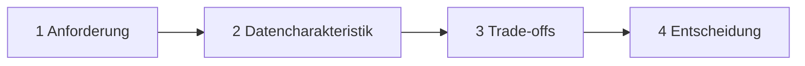
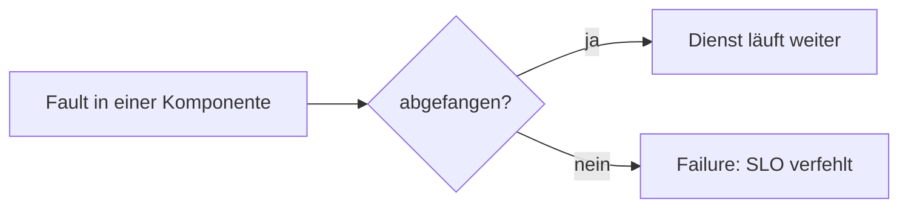
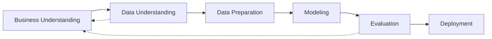
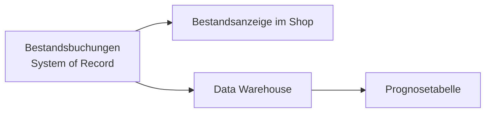

# Lernpaket T1 in einer Datei

Alle Teile des Lernpakets hintereinander, für den Upload in einen AI-Agenten oder zum Lesen am Stück: README, Glossar, Konzeptpfad, die Konzeptseiten mit Status Pflicht und Kern, Aufgaben, Übung, So fragt die Klausur, Prompts. Seiten mit Status Ausblick sind nicht enthalten; Links darauf führen ins Repo. Diese Datei im Repo: https://raw.githubusercontent.com/muehlburger/bid-ws2026/main/lernpakete/T1/T1_komplett.md. Erzeugt mit build_lernpaket.py; nicht von Hand ändern. Für deinen Agenten gilt der Rahmenprompt am Ende der Datei: Er ist Coach, nicht Ghostwriter.

<a id="readme"></a>

---

# Lernpaket T1: Big Data als Architekturfrage, CRISP-DM, Datenexploration

Termin 1 der Lehrveranstaltung Big Data (BID), Samstag, 28.11.2026, 10:30 bis 14:15, Raum RC403. Dieses Paket ist die Textfassung des Termins: Es enthält alles, was du für die Aufgaben, das Quiz Q1 und die Klausuritems zu T1 brauchst. Ein Buch brauchst du nicht; Verweise auf das Buch (Kleppmann/Riccomini, Designing Data-Intensive Applications, 2. Auflage) sind Lesehinweise.

## Was du nach T1 kannst

| Nr. | Du kannst … | Wo du es übst |
|---|---|---|
| L1 | eine Anforderung des Händlers einer der vier Qualitäten Performance, Reliability, Scalability, Maintainability zuordnen, die passende Messgröße wählen und Fault von Failure unterscheiden | Aufgabe 2, Items K1 und K2 |
| L5 | die sechs Phasen von CRISP-DM beschreiben und auf den Händler-Fall anwenden | Aufgabe 2, Items K3 und K4 |
| L8 | für einen Datensatz Skalenniveau, Kenngröße und Diagramm wählen, Median und Mittelwert berechnen und eine strukturelle 0 von einem fehlenden Wert unterscheiden | Übung Notebook, Items K5 und K6 |
| L10 | für ein Szenario Batch oder Stream und ein Rechner oder mehrere entscheiden, mit den vier Qualitäten begründen und die Bedingung nennen, unter der die andere Entscheidung richtig wäre | Aufgabe 1, Items K7 und K8 |

## Fahrplan des Termins

| Uhrzeit | Block | Inhalt | Lernziel | Agent |
|---|---|---|---|---|
| 10:30 | Start | Einstiegsfrage am Fall (Vorschlag um 6 Uhr, „noch 2 Stück in Graz“: wie alt dürfen die Daten sein?), Vorstellung, Arbeitsweise, Regeln, Gruppen bilden | – | – |
| 10:50 | Input 1 | Wann wird aus einem Datenproblem ein Architekturproblem? 5V, vier Qualitäten, Entscheidungskette, Batch oder Streaming | L1 | – |
| 11:07 | Aufgabe 1 | Vier Szenarien (S1 und S2 für alle, S3 und S4 Transfer), fünf Leitfragen, je Szenario ein Begründungssatz und eine Bedingung (Gruppe) | L10 | ohne |
| 11:32 | Musterlösung 1 | Auflösung entlang der Kette; Items K1 und K7 | L10 | – |
| 11:42 | Input 2 | CRISP-DM und das Case Canvas | L5 | – |
| 12:00 | Pause | Gruppenwahl in Moodle | – | – |
| 12:45 | Rückblick | Sechs Phasen ohne Unterlagen | L5 | ohne |
| 12:48 | Aufgabe 2 | Canvas-Felder 1 bis 3 für den Händler-Fall (Gruppe) | L1 | ohne |
| 13:10 | Musterlösung 2 | Musterbeispiel, häufige Fragen; Item K3 | L5 | – |
| 13:20 | Input 3 | Skalenniveau, Diagramm, Kenngröße; der Datensatz | L8 | – |
| 13:35 | Aufgabe 3 | Notebook NB1 Teil A, drei Fragen an den Datensatz (Paar) | L8 | ohne |
| 14:00 | Musterlösung 3 | Der Sonntag fehlt im Profil, Median gegen Mittelwert; Items K5 und K6 | L8 | – |
| 14:08 | Abschluss | Drei Sätze zur Einstiegsfrage, Quiz Q1, Gruppenwahl, Ausblick auf T2 | – | – |

Im Termin laufen alle drei Aufgaben ohne Agent, weil du zuerst die Arbeitsweise kennenlernst. Zu Hause gelten die drei Phasen aus [aufgaben.md](#aufgaben): ohne Agent, mit Agent, ohne Agent.

## So lernst du mit diesem Paket

1. **Konzeptpfad lesen und Selbsttests machen.** [konzepte.md](#konzepte) sagt dir, welche Seiten in `konzepte/` Pflicht sind und in welcher Reihenfolge. Jede Seite endet mit drei Selbsttestfragen.
2. **Aufgaben in drei Phasen bearbeiten.** [aufgaben.md](#aufgaben) und [uebung-notebook.md](#uebung-notebook): zuerst ohne Agent entscheiden oder rechnen, dann den Agenten prüfen lassen, dann ohne Agent etwas Neues wiedergeben. Die Selbstkontrolle steht am Ende jeder Datei.
3. **Zum Schluss ohne Agent:** [so-fragt-die-klausur.md](#so-fragt-die-klausur). Erst lösen, dann mit den Lösungen vergleichen.

Richtwert für zu Hause: rund eine Stunde für dieses Paket, dazu Quiz Q1 in Moodle (10 bis 15 Minuten, beliebig wiederholbar, unbenotet). Der Gesamtaufwand des Selbststudiums liegt laut Beschreibung der Lehrveranstaltung bei rund fünf Stunden je Termin einschließlich Klausurvorbereitung.

## Dateien

| Datei | Inhalt |
|---|---|
| [konzepte.md](#konzepte) | Konzeptpfad: welche Seite wann, Status Pflicht, Kern oder Ausblick |
| `konzepte/` | Konzeptseiten in eigenen Worten mit Beispiel am Modehändler und Selbsttest (erzeugt aus dem Wiki der Lehrveranstaltung) |
| [begriffe.md](#begriffe) | Glossar: jeder Begriff in einem Satz (erzeugt) |
| [aufgaben.md](#aufgaben) | Aufgabe 1 Szenarien und Aufgabe 2 Case Canvas mit Phasen, zwei Stufen und Selbstkontrolle |
| [uebung-notebook.md](#uebung-notebook) | Aufgabe 3: praktische Übung mit dem Notebook, mit Papierfassung |
| [so-fragt-die-klausur.md](#so-fragt-die-klausur) | die acht Beispielitems K1 bis K8 mit Lösungen |
| [prompts.md](#prompts) | Rahmenprompt und Prompts für deinen Agenten |
| [T1_komplett.md](https://github.com/muehlburger/bid-ws2026/blob/main/lernpakete/T1/T1_komplett.md) | alles in einer Datei, zum Hochladen in deinen Agenten (erzeugt) |

Datensatz und Notebook liegen in diesem Repo unter `data/clean/` und `notebooks/`; der Einstieg steht in der [README des Repos](#readme).

## Regeln für den Agenten

Dein AI-Agent (Claude, ChatGPT oder ein anderer) ist Coach, nicht Ghostwriter: Er erklärt, prüft deine Begründung und fragt dich ab. In den Phasen „ohne Agent“ bleiben die Geräte zu, weil die Klausur ohne Agent läuft. Gib nie Daten deines Arbeitgebers in einen Agenten; der Modehändler und der synthetische Datensatz genügen für alles. Die ausführlichen Regeln stehen in der [AGENTS.md des Repos](https://github.com/muehlburger/bid-ws2026/blob/main/lernpakete/T1/../../AGENTS.md).

<a id="begriffe"></a>

---

# Begriffe zu T1

Erzeugt aus den Konzeptseiten des Pakets (Abschnitt „In einem Satz“); nicht von Hand ändern. Fachbegriffe bleiben Englisch, die deutsche Erklärung steht in Klammern. Jede Zeile führt zur Seite mit Mechanismus, Beispiel am Modehändler und Selbsttest.

| Begriff | In einem Satz | Seite |
|---|---|---|
| Batch vs. Stream | Batch verarbeitet eine abgeschlossene Datenmenge in einem Lauf, Stream verarbeitet eine endlose Folge von Events fortlaufend; der eigentliche Unterschied ist, ob die Eingabe ein Ende hat. | [Batch vs. Stream](#batch-vs-stream) |
| Big Data und die 5V | Big Data liegt vor, wenn Menge, Geschwindigkeit oder Vielfalt der Daten die Verarbeitungskapazität der bisher angemessenen Werkzeuge übersteigen; die 5V (Volume, Velocity, Variety, Veracity, Value) sind Merkmale, mit denen man Daten beschreibt, keine Definition „Big Data = groß“. | [Big Data und die 5V](#big-data-5v) |
| CRISP-DM | CRISP-DM (Cross-Industry Standard Process for Data Mining) ist ein Orientierungsrahmen für Datenprojekte mit sechs Phasen: Business Understanding, Data Understanding, Data Preparation, Modeling, Evaluation, Deployment; Rücksprünge zwischen den Phasen sind normal. | [CRISP-DM](#crisp-dm) |
| Derived Data | Derived Data (abgeleitete Daten) entstehen, indem vorhandene Daten kopiert, umgeformt oder verdichtet werden; sie sind redundant, lassen sich aber jederzeit aus ihrer Quelle neu erzeugen. | [Derived Data](#derived-data) |
| Entscheidungskette | Die Entscheidungskette (eigene Synthese dieser Lehrveranstaltung, kein Begriff des Buches) ordnet jede Architekturentscheidung in vier Stufen: Anforderung, Datencharakteristik, Einschränkungen und Trade-offs, Entscheidung; Technologien kommen zuletzt. | [Entscheidungskette](#entscheidungskette) |
| Fault vs. Failure | Ein Fault (Fehlerzustand) liegt vor, wenn ein Teil des Systems nicht mehr richtig arbeitet; ein Failure (Ausfall) liegt vor, wenn das System als Ganzes den geforderten Dienst nicht mehr erbringt. | [Fault vs. Failure](#fault-vs-failure) |
| Kapitel 2 – Defining Nonfunctional Requirements | Funktionale Anforderungen sagen, was ein System tun soll. Nichtfunktionale Anforderungen (Nonfunctional Requirements) sagen, wie gut: wie schnell, wie zuverlässig, bei welcher Last, mit welchem Pflegeaufwand. Das Kapitel gibt diesen vier Eigenschaften eine genaue Bedeutung und Messgrößen. Damit wird aus dem Wunsch *schnell und stabil* etwas, das sich vereinbaren, prüfen und bezahlen lässt. | [Kapitel 2 – Defining Nonfunctional Requirements](#kap-02) |
| Maintainability | Maintainability (Wartbarkeit) beschreibt, wie leicht sich ein System über Jahre betreiben, verstehen und verändern lässt. | [Maintainability](#maintainability) |
| Operational vs. Analytical Systems (OLTP vs. OLAP) | Operative Systeme (OLTP, Online Transaction Processing) erfassen und ändern einzelne Datensätze im Tagesgeschäft; analytische Systeme (OLAP, Online Analytical Processing) werten sehr viele Datensätze gemeinsam aus, um Entscheidungen zu unterstützen. | [Operational vs. Analytical Systems (OLTP vs. OLAP)](#operational-vs-analytical-systems) |
| Percentiles | Ein Percentile (Perzentil) gibt an, unter welchem Wert ein bestimmter Anteil aller Messungen liegt: Beim 95. Perzentil (p95) der Response Time sind 95 von 100 Anfragen schneller und 5 langsamer. | [Percentiles](#percentiles) |
| Response Time | Die Response Time (Antwortzeit) ist die Zeit vom Absenden einer Anfrage bis zum Eintreffen der Antwort, gemessen dort, wo die Nutzerin sitzt. | [Response Time](#response-time) |
| Scalability | Scalability (Skalierbarkeit) beschreibt, wie gut ein System mit wachsender Last zurechtkommt und was man tun muss, damit die Leistung bei mehr Last erhalten bleibt. | [Scalability](#scalability) |
| Scaling up vs. Scaling out | Scaling up (vertikal skalieren) heißt, auf eine stärkere Maschine umzuziehen; Scaling out (horizontal skalieren) heißt, die Last auf mehrere Maschinen zu verteilen. | [Scaling up vs. Scaling out](#scaling-up-vs-scaling-out) |
| Simplicity | Simplicity (Einfachheit) bedeutet, ein System so zu bauen, dass Menschen es verstehen können, indem man unnötige Komplexität vermeidet. | [Simplicity](#simplicity) |
| Skalenniveau und Kenngrößen | Das Skalenniveau eines Merkmals (nominal, ordinal, metrisch) bestimmt, welches Diagramm und welche Kenngröße sinnvoll sind; bei schiefen Verteilungen beschreibt der Median den typischen Fall, der Mittelwert das Gesamtvolumen. | [Skalenniveau und Kenngrößen](#skalenniveau-und-kenngroessen) |
| System of Record | Ein System of Record (führendes System, auch *Source of Truth*) ist der Ort, an dem eine Information zum ersten Mal und verbindlich festgehalten wird; widersprechen sich zwei Systeme, gilt sein Wert. | [System of Record](#system-of-record) |
| Timeliness | Timeliness (Aktualität) ist die Eigenschaft, dass Nutzer den Zustand eines Systems auf aktuellem Stand sehen; eine Verletzung ist vorübergehend und heilt durch Warten. | [Timeliness](#timeliness) |
| Verteilt vs. Single-Node | Ein verteiltes System besteht aus mehreren Rechnern (Nodes, Knoten), die über ein Netzwerk zusammenarbeiten; ein Single-Node-System erledigt die Aufgabe auf einer einzigen Maschine. | [Verteilt vs. Single-Node](#distributed-vs-single-node) |

<a id="konzepte"></a>

---

# Konzeptpfad T1

Lies die Seiten in dieser Reihenfolge. **Pflicht** und **Kern** sind klausurrelevant und stehen auch in [T1_komplett.md](https://github.com/muehlburger/bid-ws2026/blob/main/lernpakete/T1/T1_komplett.md); **Ausblick** ist Vertiefung für Interessierte und wird in T1 nicht geprüft. Die Leitfrage sagt, worum es im Termin geht; die Seite erklärt das Konzept zeitlos. Jede Seite endet mit drei Selbsttestfragen.

## Zyklus 1: Wann wird aus einem Datenproblem ein Architekturproblem?

| Nr. | Seite | Leitfrage im Termin | Lernziel | Status | Lesezeit |
|---|---|---|---|---|---|
| 1 | [Entscheidungskette](#entscheidungskette) | In welcher Reihenfolge begründe ich eine Architekturentscheidung? | L10 | Pflicht | 5 min |
| 2 | [Big Data und die 5V](#big-data-5v) | Welche Merkmale der Daten sind im Szenario relevant, und was folgt daraus noch nicht? | L1 | Pflicht | 5 min |
| 3 | [Verteilt vs. Single-Node](#distributed-vs-single-node) | Welches Problem zwingt uns zu einem verteilten System? | L10 | Pflicht | 6 min |
| 4 | [Kapitel 2: Nonfunctional Requirements](#kap-02) | Welche vier Qualitäten messen jede Entscheidung, und mit welcher Messgröße? | L1 | Pflicht | 5 min |
| 5 | [Fault vs. Failure](#fault-vs-failure) | Was darf beim Händler kaputtgehen, ohne dass der Dienst ausfällt? | L1 | Pflicht | 5 min |
| 6 | [Batch vs. Stream](#batch-vs-stream) | Welche Anforderung rechtfertigt Streaming, und welche nicht? | L10 | Pflicht | 6 min |
| 7 | [Timeliness](#timeliness) | Warum ist Aktualität etwas anderes als Antwortzeit und Datenrate? | L10 | Kern | 5 min |
| 8 | [Scalability](#scalability) | Was heißt „skaliert“ ohne Angabe der Last? | L1 | Kern | 5 min |
| 9 | [Scaling up vs. Scaling out](#scaling-up-vs-scaling-out) | Vertikal zuerst oder horizontal: Was kostet welcher Weg? | L10 | Kern | 5 min |
| 10 | [Response Time](#response-time) | Woraus besteht die Antwortzeit der Bestandsanzeige? | L1 | Kern | 4 min |
| 11 | [Maintainability](#maintainability) | Wer betreibt und ändert das System in fünf Jahren? | L1 | Kern | 4 min |
| 12 | [Simplicity](#simplicity) | Welche Komplexität ist wesentlich, welche zufällig? | L10 | Kern | 4 min |
| 13 | [Operational vs. Analytical Systems](#operational-vs-analytical-systems) | Ist die Prognose ein operativer oder ein analytischer Zugriff? | L1 | Kern | 5 min |
| 14 | [Load](https://github.com/muehlburger/bid-ws2026/blob/main/lernpakete/T1/konzepte/load.md) | Wie rechnet man Geschäftszahlen in Last pro Sekunde um? | L1 | Ausblick | 5 min |
| 15 | [Fault Tolerance](https://github.com/muehlburger/bid-ws2026/blob/main/lernpakete/T1/konzepte/fault-tolerance.md) | Wie verhindert man, dass aus einem Fault ein Failure wird? | L1 | Ausblick | 5 min |
| 16 | [Column-Oriented Storage](https://github.com/muehlburger/bid-ws2026/blob/main/lernpakete/T1/konzepte/column-oriented-storage.md) | Warum schafft ein Rechner 50 Mio. Zeilen? (Vertiefung, Stoff von T2) | L10 | Ausblick | 5 min |

## Zyklus 2: CRISP-DM und das Case Canvas

| Nr. | Seite | Leitfrage im Termin | Lernziel | Status | Lesezeit |
|---|---|---|---|---|---|
| 17 | [CRISP-DM](#crisp-dm) | Welche Entscheidung soll besser werden, und in welcher Phase stehen wir? | L5 | Pflicht | 5 min |
| 18 | [System of Record](#system-of-record) | Was ist die Wahrheit, der Bon oder der Bestand? (Canvas-Feld 5, Vorschau auf T2) | L1 | Kern | 4 min |
| 19 | [Derived Data](#derived-data) | Warum ist die Prognose abgeleitete Information? | L5 | Kern | 4 min |

## Zyklus 3: Datenexploration

| Nr. | Seite | Leitfrage im Termin | Lernziel | Status | Lesezeit |
|---|---|---|---|---|---|
| 20 | [Skalenniveau und Kenngrößen](#skalenniveau-und-kenngroessen) | Welches Diagramm und welche Kenngröße passen zum Merkmal? Was ist der Sonntag ohne Zeile? | L8 | Pflicht | 6 min |
| 21 | [Percentiles](#percentiles) | Warum beschreiben Median und p95 eine Verteilung besser als der Mittelwert? | L8 | Pflicht | 5 min |
| 22 | [Star Schema](https://github.com/muehlburger/bid-ws2026/blob/main/lernpakete/T1/konzepte/star-schema.md) | Wie ist der Übungsdatensatz aufgebaut? (Vertiefung, Stoff von T2) | L8 | Ausblick | 4 min |
| 23 | [Selbsttest Kapitel 1 und 2](https://github.com/muehlburger/bid-ws2026/blob/main/lernpakete/T1/konzepte/fragen-kap-01-02.md) | Zwölf Fragen in den Formen der Klausur | L1 | Ausblick | 15 min |

Lesezeit für Pflicht und Kern: rund 80 Minuten, verteilt auf die Woche vor und nach dem Termin. Wer wenig Zeit hat, liest die Pflichtseiten und macht die Selbsttests; das reicht für Q1.

<a id="entscheidungskette"></a>

---

# Entscheidungskette

## In einem Satz

Die Entscheidungskette (eigene Synthese dieser Lehrveranstaltung, kein Begriff des Buches) ordnet jede Architekturentscheidung in vier Stufen: Anforderung, Datencharakteristik, Einschränkungen und Trade-offs, Entscheidung; Technologien kommen zuletzt.

## Warum das wichtig ist

Die teuersten Fehler in Datenprojekten entstehen, wenn jemand mit der Technologie beginnt: „Wir brauchen ein Cluster“, „wir brauchen Streaming“. Die Kette zwingt dazu, zuerst zu sagen, was die Anwendung verlangt, und erst am Ende, womit man es baut. Kernbotschaft: Große Datenmengen allein rechtfertigen noch kein verteiltes System.

## Wie es funktioniert

| Stufe | Frage | Woher die Antwort kommt |
|---|---|---|
| 1 Anforderung | Wie aktuell, wie oft, wie viel, wie verfügbar, wie skalierbar muss es sein? | die vier Qualitäten aus [Kapitel 2](#kap-02): Performance, Reliability, Scalability, Maintainability |
| 2 Datencharakteristik | Welche Merkmale der Daten sind hier wirklich relevant? | die [5V](#big-data-5v) als Fragen, nicht als Urteil |
| 3 Einschränkungen und Trade-offs | Was kostet mehr Aktualität, mehr Verteilung, mehr Betrieb, und was bringt es? | [Verteilt vs. Single-Node](#distributed-vs-single-node), [Batch vs. Stream](#batch-vs-stream), [Simplicity](#simplicity) |
| 4 Entscheidung | Welche ist die einfachste ausreichende Lösung? Unter welcher Bedingung wäre die andere richtig? | Technologien erst jetzt, als Beispiele |

Die Reihenfolge ist Pflicht. Wer bei Stufe 4 beginnt, begründet rückwärts und übersieht, dass die Anforderung die Komplexität oft gar nicht verlangt.



Das Diagramm zeigt die vier Stufen als Kette von links nach rechts; jede Stufe setzt die vorige voraus.

## Am Modehändler

Nächtliche Absatzprognose: (1) Ergebnis bis 6 Uhr, einmal täglich, Ausfall einer Nacht verkraftbar. (2) Rund 50 Mio. Umsatzzeilen Historie, 20.000 neue je Tag, langsames Wachstum. (3) Streaming brächte Aktualität, die niemand braucht; ein Cluster brächte Betrieb und Fehlersuche ohne Nutzen. (4) Nächtlicher Batch auf einem Rechner. Andere Entscheidung erst, wenn der Lauf das Nachtfenster sprengt, die Daten nicht mehr auf einen Rechner passen, ein Ausfall nicht tolerierbar ist oder das Zehnfache absehbar ist.

Bestandsanzeige „noch 2 Stück in Graz“: dieselbe Datenrate, aber Stufe 1 verlangt Aktualität in Sekunden. Deshalb Stream, obwohl die Datenmenge je Ereignis winzig ist.

## Trade-offs und Entscheidungsregel

- Jede Begründung nennt alle vier Stufen in dieser Reihenfolge, auch wenn eine Stufe nur einen Satz braucht.
- Die einfachste ausreichende Lösung gewinnt; jeder zusätzliche Baustein braucht ein Problem, das er löst.
- Eine vollständige Entscheidung nennt auch die Bedingung, unter der die andere Entscheidung richtig wäre.
- Preis: Die Kette verlangt Zahlen zur Anforderung (Stunden, Sekunden, Zeilen); „schnell“ und „viel“ reichen nicht.

## Typische Fehlvorstellungen

- „Volume vorhanden, also verteilt.“ Die Menge allein erzwingt nichts.
- „Die Filialen sind verteilt, also Streaming.“ Datenherkunft ist nicht Architektur.
- „Excel schafft es nicht, also Big Data.“ Der Maßstab sind angemessene Werkzeuge, nicht die Tabellenkalkulation.
- „Echtzeit ist immer besser.“ Jede Sekunde weniger Verzögerung kostet Komplexität.

## Selbsttest

1. Nenne die vier Stufen in der richtigen Reihenfolge.
2. Ein Team schlägt Streaming für den Monatsbericht vor. Welche Stufe fehlt in der Begründung?
3. Was muss eine vollständige Begründung außer der Entscheidung noch nennen?

<details><summary>Lösung</summary>

1. Anforderung, Datencharakteristik, Einschränkungen und Trade-offs, Entscheidung.
2. Stufe 1: Der Monatsbericht verlangt keine Aktualität in Sekunden; Batch reicht.
3. Die Bedingung, unter der die andere Entscheidung richtig wäre.

</details>

## Frag deinen AI-Agenten

- *Hier ist meine Begründung für ein Szenario: „…“. Prüfe sie gegen die vier Stufen der Entscheidungskette aus [Entscheidungskette](#entscheidungskette) und sag mir, welche Stufe fehlt oder nicht stimmt. Formuliere die Begründung nicht für mich.*
- *Gib mir eine neue Situation beim Modehändler in vier Sätzen. Ich entscheide entlang der Kette; du greifst die schwächste Stufe an.*

## Verwandt

- [Big Data und die 5V](#big-data-5v)
- [Verteilt vs. Single-Node](#distributed-vs-single-node)
- [Batch vs. Stream](#batch-vs-stream)
- [Wegweiser Kapitel 2](#kap-02)

## Quelle und Weiterlesen

- Eigene didaktische Synthese dieser Lehrveranstaltung in Anlehnung an DDIA 2e, Kap. 1 „Distributed Versus Single-Node Systems“ S. 19 und DDIA 2e, Kap. 2 „Defining Nonfunctional Requirements“ S. 33. Das Buch kennt keine Kette dieses Namens; Stufe 1 folgt der Gliederung von Kapitel 2.

<a id="big-data-5v"></a>

---

# Big Data und die 5V

## In einem Satz

Big Data liegt vor, wenn Menge, Geschwindigkeit oder Vielfalt der Daten die Verarbeitungskapazität der bisher angemessenen Werkzeuge übersteigen; die 5V (Volume, Velocity, Variety, Veracity, Value) sind Merkmale, mit denen man Daten beschreibt, keine Definition „Big Data = groß“.

## Warum das wichtig ist

Das Wort „Big Data“ löst Reflexe aus: Cluster, Streaming, neue Plattform. Die 5V bremsen den Reflex, weil sie Fragen stellen statt Urteile zu fällen. Welches V ist in diesem Szenario wirklich relevant, und was folgt daraus noch nicht? Die drei ersten V gehen auf Laney (2001) zurück; Veracity ergänzte IBM um 2012 als Maß für die Unsicherheit der Daten, Value kam aus der Praxis dazu. Im Buch kommen die V nicht vor; es spricht von Last, Datenmenge und Anforderungen. Was wir unter Veracity fassen, behandelt das Buch unter Reliability (Kap. 2 S. 43: ein Kassenausfall ist ein Fault) und Integrity (Kap. 13 S. 571: keine Daten verloren, keine doppelt).

## Wie es funktioniert

| Merkmal | Bedeutung | Frage an ein Szenario |
|---|---|---|
| Volume | Menge | Wie viele Zeilen, wie viele Gigabyte, wie schnell wächst es? |
| Velocity | Datenrate, also wie schnell Daten entstehen | Wie viele Ereignisse je Sekunde oder je Tag? |
| Variety | Vielfalt der Quellen und Formate | Tabellen, Ereignisströme, Freitext, Bilder? |
| Veracity | Richtigkeit und Vertrauenswürdigkeit der Daten | Lücken, Duplikate, Fehlbuchungen, unklare Herkunft? |
| Value | Nutzen | Welche Entscheidung wird damit besser? |

Zwei Dinge sind getrennt zu halten. Erstens: Velocity ist die Datenrate und nicht die Frage, wie schnell ein Ergebnis gebraucht wird; das ist eine Anforderung der Anwendung ([Timeliness](#timeliness)). Zweitens: Ob Daten „big“ sind, ist relativ zur Verarbeitungskapazität angemessener Werkzeuge. Eine Datenbank oder eine spaltenorientierte Engine verarbeitet 50 Mio. Zeilen auf einem Rechner; dass eine Tabellenkalkulation daran scheitert, macht die Daten nicht zu Big Data ([Verteilt vs. Single-Node](#distributed-vs-single-node)).

## Am Modehändler

Größenordnungen, keine Messwerte: rund 1,9 Mio. Umsatzzeilen je Quartal für 42 Filialen, Historie seit 2019 etwa 50 Mio. Zeilen (Volume); Kassenbons entstehen laufend, rund 20.000 Zeilen je Tag (Velocity); Stammdaten, Aktionskalender, Wetter, Rezensionen (Variety); Lücken durch Kassenausfälle, Duplikate, Fehlbuchungen (Veracity); bessere Bestellmengen, weniger Stockouts, weniger Abverkauf (Value). Für die nächtliche Prognose sind Volume und Variety relevant, erzwingen aber keine Verteilung. Für die Bestandsanzeige ist keines der V entscheidend, sondern die Aktualitätsanforderung.

## Trade-offs und Entscheidungsregel

- Jedes V ist eine Frage, keine Antwort. Erst alle fünf stellen, dann sagen, welche relevant sind und welche nicht.
- Aus einem relevanten V folgt noch keine Architektur; das klärt die [Entscheidungskette](#entscheidungskette).
- Preis der 5V: Sie sind grob. Für eine Entscheidung braucht man Zahlen ([Load](https://github.com/muehlburger/bid-ws2026/blob/main/lernpakete/T1/konzepte/load.md)).

## Typische Fehlvorstellungen

- „Big Data beginnt ab einem Terabyte.“ Es gibt keine feste Grenze; der Maßstab sind die Werkzeuge.
- „Velocity hoch, also Streaming.“ Hohe Datenrate erlaubt trotzdem einen nächtlichen Batch; niedrige Datenrate kann trotzdem Sekundenreaktion erfordern.
- „Big Data bezeichnet nur Streaming-Daten.“ Die meisten Big-Data-Auswertungen laufen im Batch.

## Selbsttest

1. Ordne zu: „Kassenbons entstehen laufend“, „Wetter und Rezensionen werden kombiniert“, „Kassenausfälle erzeugen Lücken“, „Historie seit 2019“.
2. Richtig oder falsch: Eine Stammdatentabelle mit 84 Filialen ist ein Big-Data-Problem, weil sie zu einem Big-Data-System gehört.
3. Warum ist „Excel schafft es nicht“ kein Argument für Big Data?

<details><summary>Lösung</summary>

1. Velocity, Variety, Veracity, Volume.
2. Falsch. Sie kann Teil eines Big-Data-Systems sein, ist aber selbst klein, statisch und selten genutzt.
3. Der Maßstab ist die Verarbeitungskapazität angemessener Werkzeuge, etwa einer Datenbank, nicht die der Tabellenkalkulation.

</details>

## Frag deinen AI-Agenten

- *Erkläre mir die 5V anhand der Seite `big-data-5v.md` im Lernpaket am Modehändler und stelle mir danach ein Szenario, in dem ich sage, welche V relevant sind und welche nicht.*
- *Ich habe Velocity und Aktualität verwechselt. Stelle beide in einer Tabelle gegenüber und frage mich dann an zwei Beispielen ab.*

## Verwandt

- [Entscheidungskette](#entscheidungskette)
- [Load](https://github.com/muehlburger/bid-ws2026/blob/main/lernpakete/T1/konzepte/load.md)
- [Timeliness](#timeliness)
- [Verteilt vs. Single-Node](#distributed-vs-single-node)

## Quelle und Weiterlesen

- Laney, D. (2001): 3D Data Management: Controlling Data Volume, Velocity, and Variety. META Group. Herkunft der ersten drei V.
- DDIA 2e, Kap. 1 „Distributed Versus Single-Node Systems“ S. 19: Was ein einzelner Rechner heute schafft.

<a id="distributed-vs-single-node"></a>

---

# Verteilt vs. Single-Node

## In einem Satz

Ein verteiltes System besteht aus mehreren Rechnern (Nodes, Knoten), die über ein Netzwerk zusammenarbeiten; ein Single-Node-System erledigt die Aufgabe auf einer einzigen Maschine.

## Warum das wichtig ist

Verteilung gilt oft als Zeichen für Professionalität. Tatsächlich ist sie eine Kostenentscheidung: Sie löst bestimmte Probleme und schafft dafür neue. Die Leitfrage lautet: Welches Problem zwingt uns zu dieser zusätzlichen Komplexität?

## Wie es funktioniert

Gründe, die Verteilung erzwingen oder rechtfertigen:

- Die Aufgabe ist von Natur aus verteilt (mehrere Standorte, mehrere Geräte).
- Mehrere Cloud-Dienste arbeiten zusammen.
- [Fault Tolerance](https://github.com/muehlburger/bid-ws2026/blob/main/lernpakete/T1/konzepte/fault-tolerance.md): Fällt eine Maschine aus, übernimmt eine andere.
- [Scalability](#scalability): Datenmenge oder Last übersteigen eine Maschine.
- Kurze Wege zu weltweit verteilten Nutzerinnen.
- Elastizität bei stark schwankender Last.
- Rechtliche Vorgaben zum Speicherort.

Dem stehen die Kosten gegenüber: Jeder Aufruf über das Netz kann fehlschlagen oder hängen, ohne dass man weiß, ob er ausgeführt wurde. Aufrufe sind viel langsamer als lokale. Fehler sind schwer zu finden, und Daten über mehrere Dienste konsistent zu halten, ist Aufgabe der Anwendung. Mehr dazu in Partial Failure.

Moderne Einzelrechner haben viele Kerne, viel Hauptspeicher und schnelle Platten. Das Buch hält fest, dass ein einfaches Programm auf einem Rechner in manchen Fällen deutlich schneller ist als ein Cluster mit über hundert Kernen.

## Am Modehändler

Der Händler ist an einer Stelle zwangsläufig verteilt: 42 Filialen und ein Onlineshop buchen an verschiedenen Orten und müssen einen gemeinsamen Bestand ergeben. Der Shop soll außerdem den Ausfall eines Servers überstehen. Die nächtliche Absatzprognose dagegen passt auf eine Maschine: Rund 50 Mio. Umsatzzeilen in [spaltenorientierter Speicherung](https://github.com/muehlburger/bid-ws2026/blob/main/lernpakete/T1/konzepte/column-oriented-storage.md) verarbeitet ein Werkzeug wie DuckDB auf einem gut ausgestatteten Rechner.

## Trade-offs und Entscheidungsregel

- Schafft es eine Maschine, dann nimm eine Maschine.
- Verteile, wenn einer der oben genannten Gründe nachweislich vorliegt, und nenne ihn ausdrücklich.
- Verteile nur den Teil, der es braucht.
- Bei großen Datenmengen ist es oft günstiger, die Rechnung zu den Daten zu bringen als umgekehrt.
- Preis: mehr Betrieb, schwierigere Fehlersuche, schwächere Garantien, siehe Replication und Sharding.

## Typische Fehlvorstellungen

- „Mehr Rechner sind automatisch schneller.“ Abstimmung und Netzverkehr fressen den Gewinn oft auf.
- „Big Data braucht immer ein Cluster.“ Die Größe, ab der eine Maschine nicht mehr reicht, liegt höher als meist angenommen.
- „Verteilt heißt ausfallsicher.“ Ohne durchdachte Fehlerbehandlung fällt ein verteiltes System häufiger aus, weil mehr Teile kaputtgehen können.

## Selbsttest

1. Nenne drei legitime Gründe für ein verteiltes System.
2. Richtig oder falsch: Ein Aufruf über das Netz, der in ein Timeout läuft, wurde sicher nicht ausgeführt.
3. Welche Komponente des Modehändlers muss verteilt sein, welche nicht?

<details><summary>Lösung</summary>

1. Zum Beispiel inhärente Verteilung, Fehlertoleranz, Skalierbarkeit, Latenz, Elastizität, rechtliche Vorgaben.
2. Falsch. Man weiß es nicht; genau das macht verteilte Systeme schwierig.
3. Die Bestandsführung über 42 Filialen und Shop ist inhärent verteilt; die nächtliche Prognose kommt mit einem Rechner aus.

</details>

## Frag deinen AI-Agenten

- *Erkläre mir Verteilt vs. Single-Node anhand der Seite `distributed-vs-single-node.md` im Lernpaket: zuerst in drei Sätzen für eine Managerin, dann technisch für einen Engineer, jeweils am Modehändler.*
- *Ich schlage dir eine verteilte Architektur für eine Aufgabe vor. Frage mich nach Datenmenge, Last und Ausfalltoleranz und beurteile dann, ob ein einzelner Rechner genügt hätte.*
- *Stelle mir nacheinander drei Fragen zu Verteilt vs. Single-Node, warte jeweils auf meine Antwort und korrigiere sie nur anhand der Wiki-Seite; nenne die Stelle, auf die du dich stützt.*

## Verwandt

- [Scaling up vs. Scaling out](#scaling-up-vs-scaling-out)
- Shared-Nothing
- [Simplicity](#simplicity)
- DuckDB

## Quelle und Weiterlesen

- DDIA 2e, Kap. 1 „Distributed Versus Single-Node Systems“ S. 19
- DDIA 2e, Kap. 1 „Problems with Distributed Systems“ S. 20

<a id="kap-02"></a>

---

# Kapitel 2 – Defining Nonfunctional Requirements

## Worum es geht

Funktionale Anforderungen sagen, was ein System tun soll. Nichtfunktionale Anforderungen (Nonfunctional Requirements) sagen, wie gut: wie schnell, wie zuverlässig, bei welcher Last, mit welchem Pflegeaufwand. Das Kapitel gibt diesen vier Eigenschaften eine genaue Bedeutung und Messgrößen. Damit wird aus dem Wunsch *schnell und stabil* etwas, das sich vereinbaren, prüfen und bezahlen lässt.

Für diese Lehrveranstaltung ist es das wichtigste Grundlagenkapitel: Die Anforderungsliste, mit der jede Architekturentscheidung beginnt, entspricht seiner Gliederung.

## Die vier Eigenschaften

| Eigenschaft | Leitfrage | Seiten |
|---|---|---|
| **Performance** | Wie schnell antwortet das System, und wie viel schafft es? | [Response Time](#response-time), Throughput, [Percentiles](#percentiles), SLO und SLA |
| **Reliability** | Arbeitet es korrekt weiter, wenn etwas schiefgeht? | [Fault vs. Failure](#fault-vs-failure), [Fault Tolerance](https://github.com/muehlburger/bid-ws2026/blob/main/lernpakete/T1/konzepte/fault-tolerance.md) |
| **Scalability** | Was geschieht, wenn die Last wächst? | [Load](https://github.com/muehlburger/bid-ws2026/blob/main/lernpakete/T1/konzepte/load.md), [Scalability](#scalability), Shared-Nothing, [Scaling up vs. Scaling out](#scaling-up-vs-scaling-out) |
| **Maintainability** | Lässt es sich über Jahre betreiben, verstehen und ändern? | [Maintainability](#maintainability) (mit Operability und Evolvability), [Simplicity](#simplicity) |

## Die Fallstudie des Kapitels

Das Kapitel beginnt mit einem Rechenbeispiel aus einem sozialen Netzwerk: Soll die Startseite bei jedem Aufruf frisch aus den Tabellen zusammengestellt oder beim Schreiben vorbereitet werden? Die Lehre daraus: Lastzahlen entscheiden über die Architektur, und vorbereitete Ergebnisse verlagern Arbeit vom Lesen zum Schreiben. In diesem Wiki steht dieselbe Überlegung am Modehändler in [Load](https://github.com/muehlburger/bid-ws2026/blob/main/lernpakete/T1/konzepte/load.md) und Materialized View.

## Am Modehändler

- Performance: Die Bestandsanzeige braucht ein Ziel für das 99. Perzentil der Response Time; die nächtliche Absatzprognose braucht einen Fertigstellungszeitpunkt.
- Reliability: Der Ausfall einer Kasse darf nicht zum Ausfall der Anzeige für eine ganze Stadt werden.
- Scalability: Die Frage lautet nicht, ob das System skaliert, sondern was bei 84 statt 42 Filialen geschieht.
- Maintainability: Ein neues Bonfeld muss sich einführen lassen, ohne alle Kassen am selben Tag umzustellen.

## Lesehinweis

- Reihenfolge für den Einstieg: [Response Time](#response-time), [Percentiles](#percentiles), SLO und SLA, dann [Fault vs. Failure](#fault-vs-failure), [Load](https://github.com/muehlburger/bid-ws2026/blob/main/lernpakete/T1/konzepte/load.md), [Scalability](#scalability), zuletzt [Simplicity](#simplicity).
- Wer aus der Statistik kommt, beginnt mit [Percentiles](#percentiles): Antwortzeiten sind rechtsschief verteilt, deshalb Median und Perzentile statt Mittelwert.
- Wer aus dem Management kommt, beginnt mit SLO und SLA und [Maintainability](#maintainability).
- Achtung auf einen häufigen Kurzschluss: Eine kurze Response Time sagt nichts darüber, wie aktuell die gezeigten Daten sind. Das ist eine eigene Anforderung, siehe [Timeliness](#timeliness).
- Die Klausur fragt aus diesem Kapitel vor allem Zuordnungen (Fault oder Failure), kleine Rechnungen (Perzentile, Last, Verfügbarkeit) und Szenario-Entscheidungen (Scaling up oder out).

## Selbsttest

[Selbsttest zu Kapitel 1 und 2](https://github.com/muehlburger/bid-ws2026/blob/main/lernpakete/T1/konzepte/fragen-kap-01-02.md)

## Quelle und Weiterlesen

- DDIA 2e, Kap. 2 „Defining Nonfunctional Requirements“ S. 33
- DDIA 2e, Kap. 2 „Case Study: Social Network Home Timelines“ S. 34
- DDIA 2e, Kap. 2 „Describing Performance“ S. 37
- DDIA 2e, Kap. 2 „Reliability and Fault Tolerance“ S. 43
- DDIA 2e, Kap. 2 „Scalability“ S. 49
- DDIA 2e, Kap. 2 „Maintainability“ S. 52

<a id="fault-vs-failure"></a>

---

# Fault vs. Failure

## In einem Satz

Ein Fault (Fehlerzustand) liegt vor, wenn ein Teil des Systems nicht mehr richtig arbeitet; ein Failure (Ausfall) liegt vor, wenn das System als Ganzes den geforderten Dienst nicht mehr erbringt.

## Warum das wichtig ist

Reliability (Zuverlässigkeit) bedeutet, dass ein System auch dann korrekt weiterarbeitet, wenn etwas schiefgeht. Teile gehen in jedem größeren System ständig kaputt. Das Ziel ist deshalb nicht, Faults zu verhindern, sondern zu verhindern, dass aus einem Fault ein Failure wird. Die Unterscheidung lenkt Geld dorthin, wo es wirkt.

## Wie es funktioniert

| | Fault | Failure |
|---|---|---|
| Ebene | einzelne Komponente | gesamter Dienst |
| Beispiele | Festplatte defekt, Rechner abgestürzt, externer Dienst nicht erreichbar | Nutzerinnen bekommen keine oder falsche Antworten |
| Maßstab | Komponente weicht von ihrer Spezifikation ab | Dienst verfehlt sein SLO |

Ob etwas Fault oder Failure ist, hängt von der Betrachtungsebene ab: Der Ausfall einer Festplatte ist für die Platte ein Failure, für den Rechner mit gespiegelten Platten nur ein Fault.



Eine Komponente, deren Fault unmittelbar zum Failure führt, heißt *Single Point of Failure*. Das Abfangen leistet [Fault Tolerance](https://github.com/muehlburger/bid-ws2026/blob/main/lernpakete/T1/konzepte/fault-tolerance.md).

## Am Modehändler

- Kasse 3 in Graz stürzt ab, die übrigen Kassen verkaufen weiter: Fault.
- Die Internetleitung einer Filiale fällt aus, die Kasse puffert Buchungen lokal: Fault.
- Der Shop zeigt deshalb für ganz Graz eine Stunde lang keinen Bestand: Failure.
- Die Absatzprognose ist um 6 Uhr nicht fertig, das Ziel ist verfehlt: Failure.
- Ein Rechenfehler lässt alle Bestände falsch erscheinen: Failure, auch wenn technisch alles läuft.

## Trade-offs und Entscheidungsregel

- Für jede Komponente fragen: Was passiert mit dem Dienst, wenn genau sie ausfällt?
- Faults, die sich abfangen lassen, toleriert man. Faults, die sich nicht rückgängig machen lassen, etwa ein Datenabfluss an Unbefugte, muss man verhindern.
- Wie viel Zuverlässigkeit nötig ist, hängt vom Schaden ab: Ein Prototyp darf mehr riskieren als die Kassenabrechnung.

## Typische Fehlvorstellungen

- „Zuverlässig heißt: Es geht nichts kaputt.“ Zuverlässig heißt: Der Dienst bleibt erhalten, obwohl etwas kaputtgeht.
- „Ein Failure ist immer ein Absturz.“ Auch falsche Ergebnisse oder verfehlte Antwortzeiten sind Failures.
- „Faults sind seltene Ausnahmen.“ In großen Systemen sind sie Alltag.

## Selbsttest

1. Eine Festplatte im Bestandsserver fällt aus, die gespiegelte Platte übernimmt. Fault oder Failure?
2. Woran misst man, ob ein Failure vorliegt?
3. Richtig oder falsch: Ein System ohne Abstürze kann kein Failure haben.

<details><summary>Lösung</summary>

1. Fault. Der Dienst läuft weiter.
2. Am geforderten Dienst, konkret am SLO.
3. Falsch. Falsche Daten oder zu langsame Antworten sind ebenfalls Failures.

</details>

## Frag deinen AI-Agenten

- *Erkläre mir Fault vs. Failure anhand der Seite `fault-vs-failure.md` im Lernpaket: zuerst in drei Sätzen für eine Managerin, dann technisch für einen Engineer, jeweils am Modehändler.*
- *Ich nenne dir sechs Störungen aus meinem Betrieb. Lass mich jede als Fault oder Failure einordnen und frage bei jeder nach der Betrachtungsebene.*
- *Stelle mir nacheinander drei Fragen zu Fault vs. Failure, warte jeweils auf meine Antwort und korrigiere sie nur anhand der Wiki-Seite; nenne die Stelle, auf die du dich stützt.*

## Verwandt

- [Fault Tolerance](https://github.com/muehlburger/bid-ws2026/blob/main/lernpakete/T1/konzepte/fault-tolerance.md)
- SLO und SLA
- Replication
- [Wegweiser Kapitel 2](#kap-02)

## Quelle und Weiterlesen

- DDIA 2e, Kap. 2 „Reliability and Fault Tolerance“ S. 43

<a id="batch-vs-stream"></a>

---

# Batch vs. Stream

## In einem Satz

Batch verarbeitet eine abgeschlossene Datenmenge in einem Lauf, Stream verarbeitet eine endlose Folge von Events fortlaufend; der eigentliche Unterschied ist, ob die Eingabe ein Ende hat.

## Warum das wichtig ist

„Batch oder Streaming?“ ist die häufigste Architekturfrage rund um Big Data und wird oft nach Mode statt nach Bedarf entschieden. Die richtige Entscheidungsgröße ist die geforderte Aktualität ([Timeliness](#timeliness)): Wie alt darf das Ergebnis sein, und was ist es wert, wenn es jünger ist? Streaming, das niemand braucht, ist teure Komplexität; Batch, wo Sekunden zählen, liefert wertlose Zahlen.

## Wie es funktioniert

| Kriterium | Batch Processing | Stream Processing |
|---|---|---|
| Eingabe | begrenzt, bekannt („gestern“) | unbegrenzt, läuft weiter |
| Ende des Jobs | ja | nie |
| Alter des Ergebnisses | Stunden bis ein Tag | Sekunden bis Minuten |
| Kennzahl | Throughput | Verzögerung, Rückstand |
| Fehler beheben | Job neu starten | Checkpoints, Idempotenz, Replay |
| Zeitbegriff | einfach: alles liegt vor | schwierig: verspätete Events, Windowing |
| Betrieb | läuft zu festen Zeiten | läuft dauernd, braucht Überwachung rund um die Uhr |
| typische Aufgaben | Berichte, Training, ETL | Anzeigen, Alarme, Abgleich von Systemen |

Gemeinsam ist beiden das Prinzip: Eingaben werden nicht verändert, Ausgaben sind [Derived Data](#derived-data) und lassen sich neu erzeugen. Deshalb verwenden moderne Engines dieselbe Logik für beides; Batch ist dann der Sonderfall eines Streams mit Ende. Zwischenformen gibt es auch: Ein Batch im Viertelstundentakt oder ein Stream in Mikro-Stapeln liegen nahe beieinander.

## Am Modehändler

| Aufgabe des Händlers | Geforderte Aktualität | Entscheidung |
|---|---|---|
| Absatzprognose aus rund 50 Mio. Umsatzzeilen | Stand vom Vorabend | Batch, nachts |
| Montagsbericht für die Geschäftsführung | Vorwoche | Batch |
| Anzeige „noch 2 Stück in Graz“ | Sekunden bis wenige Minuten | Stream |
| Alarm bei auffälligen Retouren an einer Kasse | Minuten | Stream |
| Neuberechnung nach Änderung der Prognosemerkmale | einmalig über die Historie | Batch (Reprocessing) |

Der Kassenbon ist in beiden Welten dasselbe Event: Er fließt sofort in die Bestandsanzeige und nachts in die Historie.

## Trade-offs und Entscheidungsregel

Entscheidungsregel in drei Schritten:

1. Geforderte Aktualität als Zahl festhalten. Reicht ein Tag oder eine Stunde, ist Batch die Antwort.
2. Wenn Minuten oder Sekunden nötig sind: prüfen, ob das für den ganzen Datenfluss gilt oder nur für eine Kennzahl. Nur diese wird gestreamt.
3. Den Batch behalten, als genaue Nachrechnung und für historische Neuberechnung.

Streaming kostet Dauerbetrieb, schwierigere Tests und Antworten auf Verspätung und Doppelverarbeitung (Exactly-once im Stream). Batch kostet Wartezeit.

## Typische Fehlvorstellungen

- „Streaming ist die moderne Form, Batch die alte.“ Beide lösen verschiedene Aufgaben.
- „Big Data heißt Streaming.“ Große Datenmengen werden überwiegend im Batch ausgewertet.
- „Echtzeit schadet nie.“ Sie kostet laufend Geld und Aufmerksamkeit.
- „Man muss sich für eines entscheiden.“ Fast jedes Unternehmen betreibt beides nebeneinander.

## Selbsttest

1. Was ist der grundlegende Unterschied zwischen Batch und Stream?
2. Szenario: Die Geschäftsführung will jeden Morgen den Umsatz des Vortags je Filiale sehen. Batch oder Stream?
3. Szenario: Die Filiale soll gewarnt werden, wenn ein Artikel in der nächsten Stunde auszugehen droht. Batch oder Stream?

<details><summary>Lösung</summary>

1. Die Eingabe ist beim Batch begrenzt, beim Stream unbegrenzt.
2. Batch; Tagesaktualität genügt und der Zeitraum ist abgeschlossen.
3. Stream; die Information verliert ihren Wert innerhalb von Minuten.

</details>

## Frag deinen AI-Agenten

- „Ich nenne dir zehn Anforderungen. Frage je Anforderung nach der Aktualität und entscheide mit mir zwischen Batch und Stream.“
- „Spiele den Skeptiker: Warum braucht mein Dashboard kein Streaming?“

## Verwandt

- Batch Processing
- Stream Processing
- [Timeliness](#timeliness)
- Lambda vs. Kappa
- Selbsttest Kapitel 11 und 12

## Quelle und Weiterlesen

- DDIA 2e, Kap. 13 „Batch and Stream Processing“ S. 544
- DDIA 2e, Kap. 11 „Batch Processing“ S. 451
- DDIA 2e, Kap. 12 „Stream Processing“ S. 487

<a id="timeliness"></a>

---

# Timeliness

## In einem Satz

Timeliness (Aktualität) ist die Eigenschaft, dass Nutzer den Zustand eines Systems auf aktuellem Stand sehen; eine Verletzung ist vorübergehend und heilt durch Warten.

## Warum das wichtig ist

„Wie aktuell müssen die Daten sein?“ ist die Frage, die über Batch oder Streaming entscheidet, und sie ist eine fachliche Frage mit einer Zahl als Antwort: Sekunden, Minuten, ein Tag. Wer sie nicht stellt, baut entweder zu teuer oder liefert veraltete Information. Aktualität ist außerdem nicht dasselbe wie Geschwindigkeit: Eine Abfrage kann in Millisekunden antworten und trotzdem den Stand von gestern liefern ([Response Time](#response-time)).

## Wie es funktioniert

In Systemen mit [Derived Data](#derived-data) entsteht eine Verzögerung zwischen dem Schreiben im [System of Record](#system-of-record) und dem Sichtbarwerden in den abgeleiteten Systemen:

| Weg der Daten | typische Verzögerung (Größenordnung) |
|---|---|
| nächtlicher Batch | bis zu einem Tag |
| Batch im Stundentakt | bis zu einer Stunde |
| Stream über ein Log | Sekunden |
| gemeinsame Transaktion | keine |

Solange nur die Aktualität leidet, ist das System in einem Zustand, der „noch nicht fertig“, aber nicht falsch ist. Sobald alle Änderungen verarbeitet sind, stimmt alles (Eventual Consistency). Das unterscheidet Timeliness grundlegend von Integrity: Dort hilft Warten nicht. Wer in bestimmten Situationen sofortige Aktualität braucht, etwa dass eine Kundin ihre eigene Bestellung sofort sieht, löst das gezielt für diesen Fall (Read-after-Write).

## Am Modehändler

Drei Anforderungen des Händlers, drei verschiedene Antworten:

- **Absatzprognose:** Sie darf den Stand von gestern Abend verwenden. Ein nächtlicher Batch genügt.
- **Bestandsanzeige „noch 2 Stück in Graz“:** Ist sie eine Stunde alt, fährt die Kundin umsonst in die Filiale. Gefordert sind Sekunden bis wenige Minuten; das rechtfertigt einen Stream.
- **Kassenbon:** Der Betrag muss sofort stimmen. Das leistet die Transaktion des Kassensystems, kein abgeleitetes System.

Zeigt die Anzeige zehn Sekunden lang noch drei statt zwei Stück, ist das eine kleine Verletzung der Timeliness: ärgerlich, aber in zehn Sekunden behoben.

## Trade-offs und Entscheidungsregel

Mehr Aktualität kostet: dauerhaft laufende Verarbeitung, Überwachung, schwierigere Fehlerbehandlung. Sofortige Aktualität über Systemgrenzen verlangt Koordination, die bei Ausfällen alles anhält. Regel: Für jeden Datenfluss die geforderte Aktualität als Zahl festhalten und die einfachste Lösung wählen, die sie erfüllt. Im Zweifel ist Integrity wichtiger als Timeliness, siehe Timeliness vs. Integrity.

## Typische Fehlvorstellungen

- „Aktuell heißt schnell.“ Antwortzeit und Aktualität sind verschiedene Größen.
- „Veraltete Daten sind falsche Daten.“ Sie sind richtig für einen früheren Zeitpunkt.
- „Alle Daten müssen in Echtzeit vorliegen.“ Die meisten Entscheidungen brauchen das nicht.

## Selbsttest

1. Worin unterscheidet sich eine Verletzung der Timeliness von einer Verletzung der Integrity?
2. Eine Abfrage antwortet in 20 Millisekunden mit dem Bestand von gestern. Welche Eigenschaft ist gut, welche schlecht?
3. Szenario: Die Personalplanung für nächste Woche nutzt Umsatzdaten. Welche Aktualität reicht?

<details><summary>Lösung</summary>

1. Sie ist vorübergehend und verschwindet durch Warten; eine Integritätsverletzung bleibt, bis sie repariert wird.
2. Die Antwortzeit ist gut, die Timeliness schlecht.
3. Tagesaktualität; ein nächtlicher Batch genügt.

</details>

## Frag deinen AI-Agenten

- „Ich nenne dir sechs Datenflüsse eines Händlers. Frage mich je Fluss nach der geforderten Aktualität und schlage die einfachste Lösung vor.“
- „Erkläre den Unterschied zwischen Antwortzeit und Aktualität mit einem Alltagsbeispiel.“

## Verwandt

- Integrity
- Timeliness vs. Integrity
- [Batch vs. Stream](#batch-vs-stream)
- Replication Lag
- [Response Time](#response-time)

## Quelle und Weiterlesen

- DDIA 2e, Kap. 13 „Timeliness and Integrity“ S. 571

<a id="scalability"></a>

---

# Scalability

## In einem Satz

Scalability (Skalierbarkeit) beschreibt, wie gut ein System mit wachsender Last zurechtkommt und was man tun muss, damit die Leistung bei mehr Last erhalten bleibt.

## Warum das wichtig ist

Ein System, das heute zuverlässig läuft, tut das bei zehnfacher Last nicht automatisch. Skalierbarkeit ist aber kein Etikett, das ein Produkt hat oder nicht hat. Die Aussage *X skaliert* ist leer. Sinnvoll sind nur Fragen wie: Wenn die Last auf bestimmte Weise wächst, welche Möglichkeiten haben wir, und was kosten sie?

## Wie es funktioniert

1. **Last beschreiben:** Welche Größen wachsen? Siehe [Load](https://github.com/muehlburger/bid-ws2026/blob/main/lernpakete/T1/konzepte/load.md).
2. **Leistung beobachten:** Was passiert mit [Response Time](#response-time) und Throughput, wenn die Last steigt und die Ressourcen gleich bleiben?
3. **Ressourcen anpassen:** Um wie viel müssen sie wachsen, damit die Leistung gleich bleibt? Im Idealfall verdoppelt doppelte Hardware die tragbare Last (lineare Skalierbarkeit).

Die zwei Wege, Ressourcen zu erhöhen, vergleicht [Scaling up vs. Scaling out](#scaling-up-vs-scaling-out).

Grundsätze aus dem Buch, in eigenen Worten:

- Es gibt keine Architektur, die für jede Anwendung skaliert. Sie hängt davon ab, welche Operationen häufig sind.
- Eine Architektur, die für eine Laststufe passt, passt selten für das Zehnfache. Bei jeder Größenordnung neu nachdenken.
- Nicht weiter als etwa eine Größenordnung vorausplanen.
- Ein System in Teile zerlegen, die weitgehend unabhängig arbeiten; das ist der Kern von Sharding und Shared-Nothing.
- Nichts komplizierter machen als nötig: Reicht eine Maschine, ist sie die bessere Lösung.

## Am Modehändler

Die Lastfrage des Händlers lautet nicht *Skaliert unser System?*, sondern zum Beispiel: Was geschieht, wenn aus 42 Filialen 84 werden und sich Bons und Artikel verdoppeln? Die Bestandsanzeige braucht dann mehr Buchungen pro Sekunde; sie lässt sich nach Filialen aufteilen. Die nächtliche Absatzprognose braucht länger; ob eine größere Maschine genügt, zeigt eine Messung. Eine Verhundertfachung zu planen, wäre heute verschwendeter Aufwand.

## Trade-offs und Entscheidungsregel

- Erst messen, wo der Engpass liegt, dann dort skalieren.
- Solange das Produkt klein ist, zählen Einfachheit und Änderbarkeit mehr als hypothetische Skalierung.
- Bei vorhersehbarer Last von Hand skalieren; automatische Anpassung lohnt sich bei stark schwankender Last und bringt eigene Überraschungen.
- Skalierbarkeit kostet [Simplicity](#simplicity).

## Typische Fehlvorstellungen

- „Technologie X ist skalierbar.“ Ohne Angabe der Last und der Operationen ist die Aussage wertlos.
- „Skalierbar heißt schnell.“ Ein skalierbares System kann für die einzelne Anfrage langsam sein.
- „Man sollte von Anfang an für riesige Last bauen.“ Das bindet Aufwand und Komplexität für einen Fall, der vielleicht nie eintritt.

## Selbsttest

1. Warum ist die Aussage „unsere Datenbank skaliert“ unvollständig?
2. Was bedeutet lineare Skalierbarkeit?
3. Wie weit voraus sollte man Skalierung laut Faustregel planen?

<details><summary>Lösung</summary>

1. Sie nennt weder die Art der Last noch die Operationen noch die Kosten.
2. Doppelte Ressourcen tragen doppelte Last bei gleicher Leistung.
3. Etwa eine Größenordnung.

</details>

## Frag deinen AI-Agenten

- *Erkläre mir Scalability anhand der Seite `scalability.md` im Lernpaket: zuerst in drei Sätzen für eine Managerin, dann technisch für einen Engineer, jeweils am Modehändler.*
- *Ich behaupte: „Wir brauchen ein verteiltes System, weil wir wachsen.“ Zerlege diese Aussage mit mir in Lastparameter, Engpass und Alternativen und sag mir, was noch fehlt.*
- *Stelle mir nacheinander drei Fragen zu Scalability, warte jeweils auf meine Antwort und korrigiere sie nur anhand der Wiki-Seite; nenne die Stelle, auf die du dich stützt.*

## Verwandt

- [Load](https://github.com/muehlburger/bid-ws2026/blob/main/lernpakete/T1/konzepte/load.md)
- [Scaling up vs. Scaling out](#scaling-up-vs-scaling-out)
- Shared-Nothing
- Sharding

## Quelle und Weiterlesen

- DDIA 2e, Kap. 2 „Scalability“ S. 49
- DDIA 2e, Kap. 2 „Principles for Scalability“ S. 52

<a id="scaling-up-vs-scaling-out"></a>

---

# Scaling up vs. Scaling out

## In einem Satz

Scaling up (vertikal skalieren) heißt, auf eine stärkere Maschine umzuziehen; Scaling out (horizontal skalieren) heißt, die Last auf mehrere Maschinen zu verteilen.

## Warum das wichtig ist

Wenn ein System an seine Grenze kommt, sind das die zwei grundsätzlichen Auswege. Sie unterscheiden sich weniger in der Hardware als in den Folgen für Software, Betrieb und Risiko. Die Entscheidung bestimmt, ob das System einfach bleibt oder zu einem verteilten System wird.

## Wie es funktioniert

| | Scaling up | Scaling out |
|---|---|---|
| Vorgehen | mehr Kerne, mehr Hauptspeicher, schnellere Platten in einer Maschine | mehr Maschinen, verbunden über das Netz |
| Architektur | Shared-Memory | Shared-Nothing |
| Software | bleibt weitgehend unverändert | muss Daten aufteilen (Sharding) und Ausfälle behandeln |
| Kosten | steigen schneller als die Leistung; es gibt eine Obergrenze | wachsen etwa mit der Zahl der Knoten, dazu Betriebsaufwand |
| Ausfall | eine Maschine ist ein Single Point of Failure | einzelne Knoten dürfen ausfallen, wenn Replication eingerichtet ist |
| Standorte | einer | mehrere möglich |
| Anpassung | Umzug auf neue Maschine | Knoten hinzufügen oder entfernen |

Zum Preis der großen Maschine hält das Buch fest, dass ein Spitzenrechner mit doppelter Ausstattung in der Regel deutlich mehr als das Doppelte kostet. Umgekehrt nutzt doppelte Ausstattung nicht automatisch doppelte Last, weil Engpässe bleiben.

Die Wege schließen einander nicht aus. Üblich ist: zuerst vertikal, solange es wirtschaftlich ist, und horizontal erst dort, wo ein konkreter Grund vorliegt.

## Am Modehändler

- Die nächtliche Absatzprognose dauert zu lange. Die Daten passen in eine Maschine, die Verarbeitung ist ein einzelner Lauf: Scaling up, also mehr Kerne und Hauptspeicher, ist der einfachste Weg.
- Der Bestandsdienst stößt am Aktionssamstag an seine Grenze. Die Last teilt sich natürlich nach Filiale, und der Dienst soll den Ausfall eines Rechners überstehen: Scaling out mit Aufteilung nach Filiale.

## Trade-offs und Entscheidungsregel

- Reicht eine größere Maschine und ist ihr Ausfall verkraftbar: Scaling up.
- Übersteigt die Last jede einzelne Maschine, ist Ausfallsicherheit oder Standortverteilung gefordert oder schwankt die Last stark: Scaling out.
- Vor beidem prüfen, ob sich die Last senken lässt, etwa durch einen passenden Index oder eine Materialized View.
- Preis von Scaling out: die gesamte Komplexität verteilter Systeme, siehe [Verteilt vs. Single-Node](#distributed-vs-single-node).

## Typische Fehlvorstellungen

- „Scaling out ist die moderne, Scaling up die veraltete Lösung.“ Einzelne Maschinen sind heute sehr leistungsfähig; vertikal ist oft die vernünftigere Wahl.
- „Mit doppelt so vielen Knoten geht alles doppelt so schnell.“ Nur bei Arbeit, die sich ohne Abstimmung aufteilen lässt.
- „Scaling up hat keine Grenze, solange man zahlt.“ Irgendwann gibt es keine größere Maschine.

## Selbsttest

1. Welche Architektur gehört zu Scaling out?
2. Nenne zwei Gründe, die für Scaling out sprechen, obwohl eine größere Maschine reichen würde.
3. Szenario: Die Prognose dauert fünf Stunden und soll in drei fertig sein; die Daten passen in den Hauptspeicher eines großen Rechners. Welcher Weg?

<details><summary>Lösung</summary>

1. Shared-Nothing.
2. Ausfallsicherheit, Verteilung auf mehrere Standorte, stark schwankende Last.
3. Scaling up: größere Maschine, keine Verteilung nötig.

</details>

## Frag deinen AI-Agenten

- *Erkläre mir Scaling up vs. Scaling out anhand der Seite `scaling-up-vs-scaling-out.md` im Lernpaket: zuerst in drei Sätzen für eine Managerin, dann technisch für einen Engineer, jeweils am Modehändler.*
- *Ich schildere dir einen Engpass. Lass mich zuerst selbst zwischen Scaling up und Scaling out entscheiden und greife meine Begründung dann an ihrer schwächsten Stelle an.*
- *Stelle mir nacheinander drei Fragen zu Scaling up vs. Scaling out, warte jeweils auf meine Antwort und korrigiere sie nur anhand der Wiki-Seite; nenne die Stelle, auf die du dich stützt.*

## Verwandt

- Shared-Nothing
- [Scalability](#scalability)
- [Load](https://github.com/muehlburger/bid-ws2026/blob/main/lernpakete/T1/konzepte/load.md)
- [Simplicity](#simplicity)

## Quelle und Weiterlesen

- DDIA 2e, Kap. 2 „Shared-Memory, Shared-Disk, and Shared-Nothing Architectures“ S. 51
- DDIA 2e, Kap. 2 „Principles for Scalability“ S. 52

<a id="response-time"></a>

---

# Response Time

## In einem Satz

Die Response Time (Antwortzeit) ist die Zeit vom Absenden einer Anfrage bis zum Eintreffen der Antwort, gemessen dort, wo die Nutzerin sitzt.

## Warum das wichtig ist

Die Response Time ist das, was Menschen von der Leistung eines Systems spüren. Lange Wartezeiten kosten Umsatz und Geduld. Wer sie steuern will, muss wissen, woraus sie besteht, denn ein schnellerer Server hilft nicht, wenn die Zeit im Netz oder in einer Warteschlange vergeht.

## Wie es funktioniert

Die Response Time setzt sich aus mehreren Anteilen zusammen:

| Anteil | Bedeutung |
|---|---|
| Network Latency | Laufzeit der Nachricht im Netz, hin und zurück |
| Queueing Delay | Wartezeit, bis der Dienst die Anfrage aufgreift, etwa weil alle Prozessorkerne belegt sind |
| Service Time | Zeit, in der der Dienst die Anfrage aktiv bearbeitet |

*Latency* (Latenz) ist der Sammelbegriff für Zeit, in der eine Anfrage wartet und nicht bearbeitet wird.

Die Abbildung zeigt eine Zeitachse für Client und Service. Die Anfrage läuft schräg zum Service (Netzlaufzeit), wartet (Queueing Delay), wird bearbeitet (Service Time) und läuft zurück. Die Response Time überspannt alles.

Zwei Folgerungen: Erstens wird am Client gemessen, weil der Dienst seine eigene Warteschlange und das Netz nicht sieht. Zweitens ist die Response Time kein fester Wert. Dieselbe Anfrage dauert einmal kurz, einmal lang. Man beschreibt sie deshalb als Verteilung mit [Percentiles](#percentiles). Wenige langsame Anfragen können nachfolgende aufhalten (Head-of-Line Blocking).

## Am Modehändler

Eine Kundin öffnet im Onlineshop eine Produktseite, die den Bestand je Filiale zeigt. Der Bestandsdienst braucht für die Abfrage nur wenige Millisekunden Service Time. Trotzdem wartet die Kundin am Samstagvormittag spürbar länger, weil viele Anfragen gleichzeitig eintreffen und sich vor dem Dienst stauen. Gemessen wird deshalb im Browser, nicht nur im Dienst.

Für die nächtliche Absatzprognose ist die Response Time kein sinnvolles Maß. Dort zählen Laufzeit und Throughput.

## Trade-offs und Entscheidungsregel

- Für interaktive Systeme ist die Response Time die führende Kennzahl, für Batch-Läufe der Throughput.
- Immer aus Sicht der Nutzerin messen und Ziele als SLO festhalten.
- Vor dem Optimieren fragen, welcher Anteil dominiert: Netz, Warten oder Bearbeiten.
- Response Time ist nicht Aktualität. Eine Anzeige kann schnell antworten und trotzdem einen veralteten Bestand zeigen, siehe [Timeliness](#timeliness).

## Typische Fehlvorstellungen

- „Response Time und Service Time sind dasselbe.“ Die Service Time ist nur ein Teil.
- „Die Messung am Server genügt.“ Sie unterschlägt Netz und Wartezeit.
- „Eine schnelle Antwort bedeutet aktuelle Daten.“ Geschwindigkeit der Abfrage und Alter der Daten sind zwei verschiedene Anforderungen.

## Selbsttest

1. Nenne die drei Anteile der Response Time.
2. Richtig oder falsch: Die Service Time enthält die Wartezeit in der Warteschlange.
3. Der Bestandsdienst meldet intern sehr kurze Bearbeitungszeiten, Kundinnen klagen über Wartezeiten. Wo liegt vermutlich die Ursache?

<details><summary>Lösung</summary>

1. Network Latency, Queueing Delay, Service Time.
2. Falsch. Die Wartezeit zählt nicht zur Service Time.
3. Im Queueing Delay oder im Netz; deshalb muss am Client gemessen werden.

</details>

## Frag deinen AI-Agenten

- *Erkläre mir Response Time anhand der Seite `response-time.md` im Lernpaket: zuerst in drei Sätzen für eine Managerin, dann technisch für einen Engineer, jeweils am Modehändler.*
- *Ich beschreibe dir eine langsame Anwendung. Führe mich mit Fragen dahin, den dominierenden Anteil der Response Time zu finden, bevor du eine Maßnahme vorschlägst.*
- *Stelle mir nacheinander drei Fragen zu Response Time, warte jeweils auf meine Antwort und korrigiere sie nur anhand der Wiki-Seite; nenne die Stelle, auf die du dich stützt.*

## Verwandt

- [Percentiles](#percentiles)
- Throughput
- SLO und SLA
- [Wegweiser Kapitel 2](#kap-02)

## Quelle und Weiterlesen

- DDIA 2e, Kap. 2 „Describing Performance“ S. 37
- DDIA 2e, Kap. 2 „Latency and Response Time“ S. 38

<a id="maintainability"></a>

---

# Maintainability

## In einem Satz

Maintainability (Wartbarkeit) beschreibt, wie leicht sich ein System über Jahre betreiben, verstehen und verändern lässt.

## Warum das wichtig ist

Software wird nicht einmal gebaut und ist dann fertig. Der größere Teil des Aufwands fällt nach der ersten Inbetriebnahme an: Fehler beheben, Betrieb sichern, an neue Anforderungen anpassen. Ein System, das niemand mehr anzufassen wagt, ist ein Geschäftsrisiko. Wartbarkeit ist die nichtfunktionale Anforderung, die am leichtesten vergessen wird, weil sie am ersten Tag nichts kostet.

## Wie es funktioniert

Wartbarkeit hat drei Seiten:

| Seite | Leitfrage | Was hilft |
|---|---|---|
| **Operability** (Betreibbarkeit) | Kann das Betriebsteam das System leicht am Laufen halten? | Überwachung und Einblick in das Laufzeitverhalten, keine Abhängigkeit von einzelnen Maschinen, gute Dokumentation, vorhersehbares Verhalten, sinnvolle Voreinstellungen |
| **[Simplicity](#simplicity)** (Einfachheit) | Verstehen neue Leute das System? | bekannte Muster, gute Abstraktionen, keine unnötige Komplexität |
| **Evolvability** (Änderbarkeit) | Lässt sich das System an Unvorhergesehenes anpassen? | lose gekoppelte Teile, Schema Evolution, umkehrbare Schritte |

Zur Operability gehört eine Warnung: Automatisierung ist unverzichtbar, aber kein Selbstzweck. Was automatisch läuft, versteht irgendwann niemand mehr, und gerade die seltenen Sonderfälle bleiben am Menschen hängen.

Zur Evolvability nennt das Buch einen einfachen Prüfstein: Wie viele Entscheidungen lassen sich nicht rückgängig machen? Jede unumkehrbare Aktion macht Änderungen riskant. Das Buch dazu: „Minimizing irreversibility improves flexibility.“ (DDIA 2e, Kap. 2 „Evolvability: Making Change Easy“ S. 55)

## Am Modehändler

- Operability: Der Betrieb sieht auf einem Blick, ob alle 42 Filialen Buchungen liefern, und kann einen Server zur Wartung herausnehmen, ohne dass die Bestandsanzeige ausfällt.
- Simplicity: Die Absatzprognose läuft als ein nachvollziehbarer nächtlicher Lauf, nicht als Geflecht aus zwanzig Skripten.
- Evolvability: Ein neues Feld am Kassenbon, etwa ein Rabattcode, lässt sich einführen, ohne dass alle Kassen am selben Tag aktualisiert werden müssen, siehe Backward und Forward Compatibility. Die Umstellung der Kassendatenbank wird so geplant, dass ein Rückweg bleibt.

## Trade-offs und Entscheidungsregel

- Bei jeder Architekturentscheidung fragen: Wer betreibt das in fünf Jahren, und versteht diese Person es?
- Im Zweifel die einfachere Lösung wählen, auch wenn sie etwas langsamer ist.
- Unumkehrbare Schritte, etwa eine Datenmigration ohne Rückweg, als eigenes Risiko behandeln.
- Preis: Wartbarkeit kostet am Anfang Zeit für Dokumentation, Tests und saubere Schnittstellen; sie zahlt sich über die Lebensdauer aus.

## Typische Fehlvorstellungen

- „Wartbarkeit ist Sache der Entwicklung, nicht des Managements.“ Sie entscheidet über die laufenden Kosten.
- „Mehr Automatisierung ist immer besser.“ Nur so weit, wie das Team die Sonderfälle noch beherrscht.
- „Ein System, das läuft, ist wartbar.“ Ob es wartbar ist, zeigt sich erst bei der nächsten Änderung.

## Selbsttest

1. Nenne die drei Seiten der Maintainability.
2. Welche Eigenschaft von Entscheidungen erschwert Evolvability besonders?
3. Richtig oder falsch: Operability bedeutet, den Betrieb vollständig zu automatisieren.

<details><summary>Lösung</summary>

1. Operability, Simplicity, Evolvability.
2. Unumkehrbarkeit.
3. Falsch. Sie bedeutet, dem Betriebsteam die Arbeit leicht zu machen; Automatisierung ist ein Mittel mit Grenzen.

</details>

## Frag deinen AI-Agenten

- *Erkläre mir Maintainability anhand der Seite `maintainability.md` im Lernpaket: zuerst in drei Sätzen für eine Managerin, dann technisch für einen Engineer, jeweils am Modehändler.*
- *Ich beschreibe dir ein gewachsenes System in meiner Firma. Bewerte es mit mir entlang von Operability, Simplicity und Evolvability und nenne je Seite die erste Verbesserung.*
- *Stelle mir nacheinander drei Fragen zu Maintainability, warte jeweils auf meine Antwort und korrigiere sie nur anhand der Wiki-Seite; nenne die Stelle, auf die du dich stützt.*

## Verwandt

- [Simplicity](#simplicity)
- Schema Evolution
- [Fault Tolerance](https://github.com/muehlburger/bid-ws2026/blob/main/lernpakete/T1/konzepte/fault-tolerance.md)
- [Wegweiser Kapitel 2](#kap-02)

## Quelle und Weiterlesen

- DDIA 2e, Kap. 2 „Maintainability“ S. 52
- DDIA 2e, Kap. 2 „Operability: Making Life Easy for Operations“ S. 53
- DDIA 2e, Kap. 2 „Evolvability: Making Change Easy“ S. 55

<a id="simplicity"></a>

---

# Simplicity

## In einem Satz

Simplicity (Einfachheit) bedeutet, ein System so zu bauen, dass Menschen es verstehen können, indem man unnötige Komplexität vermeidet.

## Warum das wichtig ist

Komplexität ist der Hauptgrund, warum Softwareprojekte langsam, teuer und fehleranfällig werden. In einem unübersichtlichen System dauert jede Änderung länger, und bei jeder Änderung steigt die Gefahr, etwas Unbeabsichtigtes zu zerstören. Einfachheit ist deshalb keine Stilfrage, sondern die Voraussetzung für [Maintainability](#maintainability). Aus ihr folgt die Prüffrage dieses Kurses: Welches Problem zwingt uns zu dieser zusätzlichen Komplexität?

## Wie es funktioniert

Zwei Arten von Komplexität:

- **Essential Complexity** (wesentliche Komplexität) steckt im Problem selbst. Ein Händler mit 42 Filialen hat nun einmal 42 Orte, an denen gebucht wird.
- **Accidental Complexity** (zufällige Komplexität) entsteht nicht aus dem Problem, sondern aus der Lösung, im Buch: aus den Grenzen der Werkzeuge.

Die Grenze ist nicht scharf und verschiebt sich mit besseren Werkzeugen. Ziel ist, die zufällige Komplexität zu senken.

Das wichtigste Mittel ist **Abstraction** (Abstraktion): Eine einfache Schnittstelle verbirgt viele Details und lässt sich für viele Zwecke wiederverwenden. SQL ist ein Beispiel. Wer eine Abfrage schreibt, muss nicht wissen, wie die Daten auf der Platte liegen oder welcher Index verwendet wird.

Folgen hoher Komplexität: Budgets und Zeitpläne werden überschritten, und Änderungen bringen leichter Fehler mit, weil versteckte Annahmen und unerwartete Wechselwirkungen übersehen werden. Ein in Komplexität versunkenes Projekt heißt salopp *Big Ball of Mud*. Einen objektiven Maßstab für Einfachheit gibt es nicht.

## Am Modehändler

Zwei Entwürfe für die nächtliche Absatzprognose aus rund 50 Mio. Umsatzzeilen:

| | Entwurf A | Entwurf B |
|---|---|---|
| Aufbau | Cluster aus mehreren Rechnern mit verteilter Verarbeitung | eine gut ausgestattete Maschine mit einer spaltenorientierten Engine wie DuckDB |
| Betrieb | Cluster verwalten, Ausfälle einzelner Knoten behandeln | ein Rechner, ein Lauf |
| Reicht für die Last? | ja | ja |

Beide erfüllen die Anforderung. Entwurf A enthält Komplexität, die kein Problem des Händlers löst. Entwurf B ist die bessere Wahl, solange die Datenmenge nicht um Größenordnungen wächst. Die Filialanbindung dagegen ist wesentlich komplex: Sie lässt sich nicht wegvereinfachen, nur sauber kapseln.

## Trade-offs und Entscheidungsregel

- Die einfachste Lösung wählen, die die Anforderungen (SLO) erfüllt.
- Jeden zusätzlichen Baustein mit dem Problem begründen, das er löst.
- Weniger Bausteine sind fast immer leichter zu verstehen als mehr.
- Preis der Einfachheit: gelegentlich geringere Spitzenleistung und der Verzicht auf Vorsorge für Fälle, die vielleicht nie eintreten, siehe [Scalability](#scalability).

## Typische Fehlvorstellungen

- „Einfach heißt wenig Funktion.“ Einfach heißt: verständlich für die Aufgabe, die zu lösen ist.
- „Komplexe Architektur zeigt Kompetenz.“ Sie zeigt oft, dass niemand gefragt hat, welches Problem gelöst wird.
- „Abstraktion macht alles einfacher.“ Eine schlechte Abstraktion verbirgt Details, die man doch kennen muss.

## Selbsttest

1. Unterscheide Essential und Accidental Complexity an je einem Beispiel des Modehändlers.
2. Welches Mittel nennt das Buch als wichtigstes gegen zufällige Komplexität?
3. Richtig oder falsch: Ein Cluster ist für die nächtliche Prognose die professionellere Lösung.

<details><summary>Lösung</summary>

1. Wesentlich: 42 Filialen buchen an verschiedenen Orten. Zufällig: ein Cluster für eine Aufgabe, die eine Maschine schafft.
2. Abstraktion.
3. Falsch. Wenn eine Maschine die Anforderung erfüllt, ist sie die bessere Lösung.

</details>

## Frag deinen AI-Agenten

- *Erkläre mir Simplicity anhand der Seite `simplicity.md` im Lernpaket: zuerst in drei Sätzen für eine Managerin, dann technisch für einen Engineer, jeweils am Modehändler.*
- *Ich zeige dir eine Architekturskizze in Worten. Frage bei jedem Baustein: Welches Problem zwingt uns zu dieser Komplexität? Streiche mit mir, was keine Antwort hat.*
- *Stelle mir nacheinander drei Fragen zu Simplicity, warte jeweils auf meine Antwort und korrigiere sie nur anhand der Wiki-Seite; nenne die Stelle, auf die du dich stützt.*

## Verwandt

- [Maintainability](#maintainability)
- [Verteilt vs. Single-Node](#distributed-vs-single-node)
- [Scalability](#scalability)
- DuckDB

## Quelle und Weiterlesen

- DDIA 2e, Kap. 2 „Simplicity: Managing Complexity“ S. 54

<a id="operational-vs-analytical-systems"></a>

---

# Operational vs. Analytical Systems (OLTP vs. OLAP)

## In einem Satz

Operative Systeme (OLTP, Online Transaction Processing) erfassen und ändern einzelne Datensätze im Tagesgeschäft; analytische Systeme (OLAP, Online Analytical Processing) werten sehr viele Datensätze gemeinsam aus, um Entscheidungen zu unterstützen.

## Warum das wichtig ist

Die beiden Arbeitsweisen stellen gegensätzliche Anforderungen an Datenmodell, Speicherung und Betrieb. Wer sie in einem System vermischt, bekommt entweder langsame Kassen oder langsame Berichte. Fast jede Architekturentscheidung in diesem Wiki beginnt deshalb mit der Frage: Ist das ein operativer oder ein analytischer Zugriff?

## Wie es funktioniert

| Merkmal | Operativ (OLTP) | Analytisch (OLAP) |
|---|---|---|
| Lesen | wenige Datensätze über einen Schlüssel (Point Query) | Aggregation über sehr viele Datensätze |
| Schreiben | einzelne Datensätze anlegen, ändern, löschen | gesammeltes Laden oder Ereignisstrom |
| Nutzerinnen | Kundinnen, Verkaufspersonal über eine Anwendung | Analystinnen, Controlling, Data Scientists |
| Abfragen | fest im Programmcode | frei formuliert, explorativ |
| Datenstand | aktueller Zustand | Verlauf über die Zeit |
| Datenmenge | Gigabyte bis Terabyte | Terabyte bis Petabyte |
| Speicherung | zeilenorientiert, Index | [spaltenorientiert](https://github.com/muehlburger/bid-ws2026/blob/main/lernpakete/T1/konzepte/column-oriented-storage.md) |

Die Größenangaben sind typische Bereiche, keine festen Grenzen. Zwischen beiden Welten vermittelt ETL in ein Data Warehouse.

## Am Modehändler

- Operativ: Eine Kasse bucht einen Bon; der Shop fragt den Bestand eines Artikels in Graz ab.
- Analytisch: Das Controlling summiert den Absatz je Filiale und Woche über alle rund 50 Mio. Umsatzzeilen; die nächtliche Prognose lernt aus derselben Historie.

Die Bestandsanzeige „noch 2 Stück in Graz“ ist operativ, obwohl sie aus einem Ereignisstrom gespeist wird: Gelesen wird ein einzelner Wert über einen Schlüssel.

## Trade-offs und Entscheidungsregel

- Wenige Datensätze je Zugriff, viele gleichzeitige Nutzerinnen, kurze [Response Time](#response-time): operatives Design.
- Viele Zeilen, wenige Spalten, Aggregation, wenige Abfragen: analytisches Design.
- Beides auf frischen Daten in einer Anwendung, etwa Betrugserkennung an der Kasse: hybride Systeme (HTAP) prüfen.
- Preis der Trennung: zwei Systeme, eine Datenstrecke dazwischen und analytische Daten, die dem Betrieb hinterherhinken.

## Typische Fehlvorstellungen

- „OLTP braucht immer Transaktionen mit vollen Garantien.“ Der Begriff meint hier vor allem schnelle, kleine Lese- und Schreibzugriffe.
- „Analytik heißt Big Data.“ Viele analytische Aufgaben passen auf einen einzelnen Rechner, siehe [Verteilt vs. Single-Node](#distributed-vs-single-node).
- „Echtzeit ist operativ, Batch ist analytisch.“ Auch Analytik kann laufend rechnen, und operative Systeme haben Batch-Läufe.

## Selbsttest

1. Ordne zu: (a) Preis eines Artikels an der Kasse nachschlagen, (b) Umsatz je Warengruppe über drei Jahre, (c) Retoure buchen.
2. Richtig oder falsch: In operativen Systemen formulieren Endnutzerinnen ihre Abfragen frei.
3. Welche Speicherform passt zu welchem Systemtyp?

<details><summary>Lösung</summary>

1. (a) operativ, (b) analytisch, (c) operativ.
2. Falsch. Die Abfragen sind im Anwendungscode festgelegt.
3. Zeilenorientiert mit Indizes für operative, spaltenorientiert für analytische Systeme.

</details>

## Frag deinen AI-Agenten

- *Erkläre mir Operational vs. Analytical Systems (OLTP vs. OLAP) anhand der Seite `operational-vs-analytical-systems.md` im Lernpaket: zuerst in drei Sätzen für eine Managerin, dann technisch für einen Engineer, jeweils am Modehändler.*
- *Ich nenne dir acht Zugriffe aus meinem Unternehmen. Lass mich jeden als operativ oder analytisch einordnen und prüfe meine Begründung an den Merkmalen der Tabelle.*
- *Stelle mir nacheinander drei Fragen zu Operational vs. Analytical Systems (OLTP vs. OLAP), warte jeweils auf meine Antwort und korrigiere sie nur anhand der Wiki-Seite; nenne die Stelle, auf die du dich stützt.*

## Verwandt

- Data Warehouse
- Row vs. Column Storage
- [System of Record](#system-of-record)
- Wegweiser Kapitel 1

## Quelle und Weiterlesen

- DDIA 2e, Kap. 1 „Operational Versus Analytical Systems“ S. 3
- DDIA 2e, Kap. 1 „Characterizing Transaction Processing and Analytics“ S. 5

<a id="crisp-dm"></a>

---

# CRISP-DM

## In einem Satz

CRISP-DM (Cross-Industry Standard Process for Data Mining) ist ein Orientierungsrahmen für Datenprojekte mit sechs Phasen: Business Understanding, Data Understanding, Data Preparation, Modeling, Evaluation, Deployment; Rücksprünge zwischen den Phasen sind normal.

## Warum das wichtig ist

Wer mit den Daten beginnt („Wir haben 50 Mio. Zeilen, was können wir vorhersagen?“), optimiert am Ende eine Kennzahl, die niemand bestellt hat. CRISP-DM stellt die Geschäftsfrage an den Anfang und die Inbetriebnahme ans Ende. Merksatz: Die Prognose ist nicht das Ziel, die Bestellung ist es.

## Wie es funktioniert

| Phase | Frage | Beim Modehändler |
|---|---|---|
| 1 Business Understanding | Welche Entscheidung soll besser werden, wer trifft sie, wie oft? | Bestellmenge je Filiale und Artikel, wöchentlich |
| 2 Data Understanding | Welche Daten gibt es, was steht in einer Zeile, wo sind die Lücken? | Umsatzzeilen je Tag, Filiale, Variante; Sonntage ohne Zeile |
| 3 Data Preparation | Fehler erkennen, Wahrheit und Ableitung trennen, Format wählen, Merkmale ableiten | Datenqualität, Kalenderfeatures |
| 4 Modeling | Ein Modell bauen, als wiederholbarer Schritt | nächtliche Pipeline, Vergleich mit einer einfachen Baseline |
| 5 Evaluation | Erreicht das Modell das Geschäftsziel, und wer verantwortet es? | weniger Stockouts, weniger Abverkauf; Testdaten; Recht und Ethik |
| 6 Deployment | Wie läuft es dauerhaft, auch wenn der Händler wächst? | nächtlicher Lauf; Echtzeit-Anzeige als eigene Architekturfrage |

Die übliche (kanonische) Abfolge ist 1 bis 6. In der Praxis springt man zurück: Zeigt die Evaluation ein falsches Ziel, geht es zu Business Understanding; zeigt Data Understanding fehlende Daten, braucht es eine neue Quelle. Evaluation prüft gegen das Geschäftsziel aus Phase 1, nicht nur gegen eine technische Metrik des Modeling.



Das Diagramm zeigt die sechs Phasen als Kette mit zwei gestrichelten Rücksprüngen: von Evaluation und von Data Understanding zurück zum Business Understanding.

## Am Modehändler

Aus der Entscheidung „Bestellmenge je Filiale und Artikel“ folgen Granularität (Tag, Filiale, Variante), Horizont (7 Tage), Zielgröße und Metrik. Deployment ist kein Anhang: Hier beginnt die Architekturfrage, ob ein nächtlicher Lauf reicht oder die Anzeige im Shop einen Stream braucht.

## Trade-offs und Entscheidungsregel

- Business Understanding zuerst, auch wenn die Daten schon da sind.
- Evaluation misst am Geschäftsziel, nicht an der schönsten Metrik.
- Preis: CRISP-DM sagt nichts über Architektur, Datenqualität oder Verantwortung im Detail; dafür gibt es die weiteren Konzepte des Wikis.

## Typische Fehlvorstellungen

- „CRISP-DM legt die Reihenfolge fest.“ Es ist ein Orientierungsrahmen; Schleifen sind der Normalfall.
- „Evaluation ist die technische Modellbewertung.“ Die gehört zum Modeling; Evaluation fragt nach dem Geschäftsziel.
- „Deployment ist der letzte Schritt und damit erledigt.“ Der Betrieb über Jahre ist der teuerste Teil.

## Selbsttest

1. Bringe in die übliche Abfolge: Modeling, Business Understanding, Deployment, Data Preparation, Evaluation, Data Understanding.
2. In welcher Phase wird geprüft, ob das Prognosemodell tatsächlich weniger Stockouts bringt?
3. In welcher Phase wird geklärt, welche Entscheidung besser werden soll?

<details><summary>Lösung</summary>

1. Business Understanding, Data Understanding, Data Preparation, Modeling, Evaluation, Deployment.
2. Evaluation.
3. Business Understanding.

</details>

## Frag deinen AI-Agenten

- *Erkläre mir CRISP-DM anhand der Seite `crisp-dm.md` im Lernpaket am Modehändler und frage mich danach zu drei Situationen, in welcher Phase wir stehen.*
- *Ich beschreibe dir ein Datenprojekt aus meinem Alltag ohne Firmennamen. Hilf mir, die sechs Phasen darauf abzubilden, und sag mir, wo das Projekt die Phase 1 übersprungen hat.*

## Verwandt

- [Entscheidungskette](#entscheidungskette)
- [Derived Data](#derived-data): ein trainiertes Modell ist abgeleitete Information
- Batch Processing: der nächtliche Lauf

## Quelle und Weiterlesen

- Chapman, P. et al. (2000): CRISP-DM 1.0. Step-by-step data mining guide. Ergänzungsquelle dieser Lehrveranstaltung; im Buch kommt CRISP-DM nicht vor.

<a id="system-of-record"></a>

---

# System of Record

## In einem Satz

Ein System of Record (führendes System, auch *Source of Truth*) ist der Ort, an dem eine Information zum ersten Mal und verbindlich festgehalten wird; widersprechen sich zwei Systeme, gilt sein Wert.

## Warum das wichtig ist

Sobald Daten in mehreren Systemen liegen, entstehen Widersprüche. Wer vorab festlegt, welches System für welche Information führend ist, weiß im Streitfall, welche Zahl stimmt, was gesichert werden muss und was sich neu berechnen lässt. Das ist eine Entscheidung über Verantwortung und Budget, keine technische Feinheit.

## Wie es funktioniert

- Jede Tatsache wird im System of Record genau einmal gespeichert, meist in normalisierter Form.
- Neue Daten, etwa Eingaben von Kundinnen oder Buchungen, werden zuerst dort geschrieben.
- Alle anderen Darstellungen sind [Derived Data](#derived-data) (abgeleitete Daten): Sie entstehen durch Kopieren, Umformen oder Verdichten und dürfen jederzeit neu erzeugt werden.
- Die Rolle hängt an der Nutzung, nicht am Produkt. Dieselbe Datenbanksoftware kann an einer Stelle führend und an anderer Stelle abgeleitet sein.



Das Diagramm zeigt die Bestandsbuchungen als einzige Quelle, aus der die Shop-Anzeige direkt und die Prognosetabelle über das Data Warehouse abgeleitet werden.

## Am Modehändler

Die Bestandsbuchungen (Wareneingang, Verkauf, Retoure, Umlagerung) und die Filialstammdaten sind System of Record. Die Anzeige „noch 2 Stück in Graz“ im Onlineshop, der Suchindex für Artikel, die Faktentabelle im Data Warehouse und die Tabelle mit der nächtlichen Absatzprognose sind abgeleitet. Zeigt der Shop 2 Stück und die Buchungen ergeben 1, dann ist 1 richtig und die Anzeige wird korrigiert, nicht umgekehrt.

## Trade-offs und Entscheidungsregel

- Gehen die Daten verloren und niemand kann sie wiederherstellen, dann ist es ein System of Record: höchste Anforderungen an Sicherung, Replication und Transaktionen.
- Lassen sich die Daten aus einer anderen Quelle neu berechnen, dann sind sie abgeleitet: Hier darf auf Geschwindigkeit optimiert werden.
- Kosten: Wer ein führendes System festlegt, muss alle Schreibwege dorthin lenken. Schreibt eine Anwendung direkt in eine abgeleitete Kopie, laufen die Systeme auseinander.

## Typische Fehlvorstellungen

- „Das System of Record ist die größte oder modernste Datenbank.“ Nein, es ist eine Rolle. Auch eine einfache Datei kann führend sein.
- „Es gibt genau ein System of Record im Unternehmen.“ Nein, es gibt eines je Information: Bestand im Warenwirtschaftssystem, Kundendaten im CRM.
- „Abgeleitete Daten sind weniger wichtig.“ Sie sind für die Lesegeschwindigkeit oft unverzichtbar, aber ersetzbar.

## Selbsttest

1. Der Suchindex des Onlineshops wird versehentlich gelöscht. Ist das ein Datenverlust im engeren Sinn?
2. Richtig oder falsch: Ob eine PostgreSQL-Datenbank System of Record ist, hängt vom Produkt ab.
3. Shop-Anzeige und Buchungssystem nennen unterschiedliche Bestände. Welcher Wert gilt?

<details><summary>Lösung</summary>

1. Nein. Der Index ist abgeleitet und wird aus dem Artikelstamm neu aufgebaut; es kostet Zeit, aber keine Information.
2. Falsch. Entscheidend ist die Nutzung: Dieselbe Software kann führend oder abgeleitet sein.
3. Der Wert des Buchungssystems, weil es als System of Record festgelegt ist.

</details>

## Frag deinen AI-Agenten

- *Erkläre mir System of Record anhand der Seite `system-of-record.md` im Lernpaket: zuerst in drei Sätzen für eine Managerin, dann technisch für einen Engineer, jeweils am Modehändler.*
- *Ich nenne dir sechs Datenbestände meines Unternehmens. Frage mich zu jedem, ob er System of Record oder Derived Data ist, und prüfe meine Begründung mit der Regel „rekonstruierbar oder nicht“.*
- *Stelle mir nacheinander drei Fragen zu System of Record, warte jeweils auf meine Antwort und korrigiere sie nur anhand der Wiki-Seite; nenne die Stelle, auf die du dich stützt.*

## Verwandt

- [Derived Data](#derived-data): das Gegenstück
- Event Sourcing: ein Ereignislog als System of Record
- ETL: der Weg von führenden Systemen ins Warehouse
- Wegweiser Kapitel 1

## Quelle und Weiterlesen

- DDIA 2e, Kap. 1 „Systems of Record and Derived Data“ S. 10

<a id="derived-data"></a>

---

# Derived Data

## In einem Satz

Derived Data (abgeleitete Daten) entstehen, indem vorhandene Daten kopiert, umgeformt oder verdichtet werden; sie sind redundant, lassen sich aber jederzeit aus ihrer Quelle neu erzeugen.

## Warum das wichtig ist

Keine einzelne Darstellung bedient alle Zugriffe gut. Eine Buchungstabelle ist ideal zum Schreiben, aber zu langsam für die Shop-Anzeige und unhandlich für die Prognose. Abgeleitete Daten kaufen Lesegeschwindigkeit mit Redundanz. Für das Management heißt das: Jede zusätzliche Kopie braucht einen Verantwortlichen, der sie aktuell hält, sonst entstehen zwei Wahrheiten.

## Wie es funktioniert

Typische Formen:

| Form | Was wird abgeleitet |
|---|---|
| Cache | Ergebnis einer teuren Abfrage, kurzzeitig vorgehalten |
| Index | Suchstruktur über vorhandene Datensätze |
| Materialized View | gespeichertes Abfrageergebnis |
| Denormalisierte Kopie | zusammengeführte Tabellen, siehe Normalisierung vs. Denormalisierung |
| Trainiertes Modell | Muster aus historischen Daten |

Die Ableitung läuft entweder periodisch als Batch Processing oder laufend als Stream Processing. Geht eine Ableitung verloren, wird sie aus dem [System of Record](#system-of-record) neu gebaut. Das Buch formuliert es so: „If you lose derived data, you can re-create it from the original source.“ (DDIA 2e, Kap. 1 „Systems of Record and Derived Data“ S. 10)

## Am Modehändler

Aus den Kassenbons und Bestandsbuchungen leitet der Händler drei Dinge ab: die Bestandsanzeige im Shop (laufend), die Faktentabelle im Warehouse (nächtlich) und daraus die Absatzprognose je Artikel und Filiale. Stellt sich heraus, dass die Prognose einen Rechenfehler enthält, wird der Code korrigiert und die Prognose aus den unveränderten Umsatzzeilen neu gerechnet.

## Trade-offs und Entscheidungsregel

- Ableiten lohnt sich, wenn deutlich öfter gelesen als geschrieben wird oder wenn die Abfrage auf den Originaldaten zu teuer ist.
- Jede Ableitung kostet: Speicherplatz, Rechenzeit beim Aktualisieren und die Gefahr, dass sie der Quelle hinterherhinkt.
- Regel: Schreibe nur in die Quelle, leite alles andere automatisch ab, und halte fest, wie alt eine Ableitung höchstens sein darf.

## Typische Fehlvorstellungen

- „Redundanz ist immer schlecht.“ Unkontrollierte Redundanz ist schlecht; bewusst abgeleitete Kopien sind ein Standardwerkzeug.
- „Abgeleitete Daten sind immer aktuell.“ Zwischen Änderung der Quelle und Aktualisierung der Kopie vergeht Zeit, von Millisekunden bis zu einem Tag.
- „Ein Machine-Learning-Modell ist kein Datum.“ Im Sinne des Buches ist auch ein trainiertes Modell eine Ableitung aus Trainingsdaten.

## Selbsttest

1. Nenne drei abgeleitete Datenbestände des Modehändlers.
2. Richtig oder falsch: Abgeleitete Daten müssen nicht gesichert werden, weil sie unwichtig sind.
3. Was ist der Preis dafür, dass die Shop-Anzeige schnell aus einer abgeleiteten Tabelle liest?

<details><summary>Lösung</summary>

1. Zum Beispiel Bestandsanzeige im Shop, Suchindex, Warehouse-Faktentabelle, Prognosetabelle.
2. Falsch in der Begründung. Sie sind rekonstruierbar, aber der Neuaufbau kann Stunden dauern; ob man sie sichert, ist eine Kostenabwägung.
3. Jede Buchung muss zusätzlich die Kopie aktualisieren, und die Anzeige kann kurz veraltet sein.

</details>

## Frag deinen AI-Agenten

- *Erkläre mir Derived Data anhand der Seite `derived-data.md` im Lernpaket: zuerst in drei Sätzen für eine Managerin, dann technisch für einen Engineer, jeweils am Modehändler.*
- *Ich beschreibe dir einen Datenfluss in zwei Sätzen. Zeichne daraus eine Kette Quelle → Ableitungen und sag mir, wo eine Kopie veralten kann.*
- *Stelle mir nacheinander drei Fragen zu Derived Data, warte jeweils auf meine Antwort und korrigiere sie nur anhand der Wiki-Seite; nenne die Stelle, auf die du dich stützt.*

## Verwandt

- [System of Record](#system-of-record)
- Materialized View
- CQRS: Lesemodelle als systematische Ableitung
- Batch Processing und Stream Processing: die zwei Wege, Ableitungen zu erzeugen

## Quelle und Weiterlesen

- DDIA 2e, Kap. 1 „Systems of Record and Derived Data“ S. 10

<a id="skalenniveau-und-kenngroessen"></a>

---

# Skalenniveau und Kenngrößen

## In einem Satz

Das Skalenniveau eines Merkmals (nominal, ordinal, metrisch) bestimmt, welches Diagramm und welche Kenngröße sinnvoll sind; bei schiefen Verteilungen beschreibt der Median den typischen Fall, der Mittelwert das Gesamtvolumen.

## Warum das wichtig ist

Der Datentyp in einem Programm ist nicht das Skalenniveau: Eine Filialnummer ist eine Zahl, aber ein Name. Wer mit Filialnummern rechnet oder den Mittelwert eines schiefen Merkmals als „typisch“ berichtet, zieht falsche Schlüsse. Dieselbe Überlegung führt das Buch für Antwortzeiten: rechtsschief verteilt, deshalb Median und Perzentile statt Mittelwert ([Percentiles](#percentiles)).

## Wie es funktioniert

| Skalenniveau | Beispiel im Übungsdatensatz | Diagramm | Kenngrößen |
|---|---|---|---|
| nominal (Namen, keine Reihenfolge) | Filialnummer, Aktionskennzeichen, Marke | Balken- oder Säulendiagramm, Kreisdiagramm bei wenigen Kategorien | Häufigkeiten, Modus |
| ordinal (Reihenfolge, keine gleichen Abstände) | Größen XS bis L, Preislage | Balken in der Reihenfolge | Median, Quantile |
| metrisch (Abstände oder Verhältnisse sinnvoll) | Verkaufspreis, verkaufte Stück, Datum (Differenzen sinnvoll) | Histogramm, Boxplot | Mittelwert, Median, Quantile |

Reihenfolge der Entscheidung: zuerst das Skalenniveau, dann das Diagramm, dann die Kenngröße.

Median gegen Mittelwert am Beispiel: Tagesmengen eines Artikels 1, 1, 2, 1, 5, 1, 3. Sortiert 1, 1, 1, 1, 2, 3, 5: Der Median ist der mittlere Wert, also 1. Der Mittelwert ist 14 geteilt durch 7, also 2. Der Ausreißer 5 verschiebt den Mittelwert, den Median nicht. Regel: erst die Verteilung ansehen, dann die Kenngröße wählen.

## Am Modehändler

Im Übungsdatensatz (12 Filialen, rund 400.000 Zeilen) hat die Tagesmenge je Variante und Filiale den Median 1 und den Mittelwert rund 1,6: Zwei Drittel der Verkaufstage bringen genau ein Stück, wenige Aktionstage bis 19 Stück. Der Median beschreibt den typischen Tag; der Mittelwert berücksichtigt das Gesamtvolumen und zählt für aggregierte Mengen. Als Planungszahl taugt er nicht: Eine echte Planung braucht Kalender-, Saison- und Aktionseffekte.

Besonderheit Sonntag: Im Rohdatensatz gibt es für Sonntage keine Zeile. Erst das Domänenwissen „Filialen geschlossen“ erlaubt, in einem vollständigen Kalender eine strukturelle 0 einzutragen. Das ist kein fehlender Wert und wird weder bereinigt noch durch Nachbarwerte ersetzt. Ein Kassenausfall an einem Dienstag sieht in den Daten gleich aus und ist ein fehlender Wert. Ob die 0 in eine Prognose eingeht, hängt davon ab, ob je Kalendertag oder je Öffnungstag prognostiziert wird.

## Trade-offs und Entscheidungsregel

- Typischer Fall: Median. Gesamtvolumen und Kapazität: Mittelwert. Ausreißer und Ziele: Perzentile.
- Nominale Merkmale nie als Zahlen behandeln, auch wenn sie als Zahl gespeichert sind.
- Vor jeder Kenngröße die Verteilung zeichnen; Schiefe sieht man im Histogramm sofort.

## Typische Fehlvorstellungen

- „int64 heißt metrisch.“ Die Filialnummer ist nominal.
- „Der Mittelwert ist die Planungssumme.“ Er berücksichtigt das Volumen, ersetzt aber keine Planung.
- „Keine Zeile heißt Wert 0.“ Ohne Domänenwissen ist der Wert unbekannt.

## Selbsttest

1. Welches Diagramm zeigt die Verteilung des Verkaufspreises angemessen: Kreisdiagramm, Histogramm, Liniendiagramm über die Artikelnummer oder Balkendiagramm der Filialen?
2. Tagesmengen 2, 1, 1, 6, 1, 2, 1: Median und Mittelwert?
3. Ein Händler prognostiziert je Öffnungstag. Wie behandelt er Sonntage in der Zielreihe?

<details><summary>Lösung</summary>

1. Histogramm; der Preis ist metrisch.
2. Sortiert 1, 1, 1, 1, 2, 2, 6: Median 1, Mittelwert 14 durch 7 gleich 2.
3. Ausschließen, wie Feiertage; bei einer Prognose je Kalendertag wäre die strukturelle 0 richtig.

</details>

## Frag deinen AI-Agenten

- *Erkläre mir Skalenniveau und Kenngrößen anhand der Seite `skalenniveau-und-kenngroessen.md` im Lernpaket und nenne mir dann vier Merkmale, die ich einordne; korrigiere nur, wo ich falsch liege.*
- *Gib mir sieben Tagesmengen mit einem Ausreißer. Ich bestimme Median und Mittelwert; du sagst mir nur, in welchem Schritt ein Fehler steckt.*

## Verwandt

- [Percentiles](#percentiles)
- [Response Time](#response-time)
- DataFrames
- [Star Schema](https://github.com/muehlburger/bid-ws2026/blob/main/lernpakete/T1/konzepte/star-schema.md)

## Quelle und Weiterlesen

- Fahrmeir, L. et al.: Statistik. Der Weg zur Datenanalyse, Kap. 2 (deskriptive Statistik). Ergänzungsquelle dieser Lehrveranstaltung.
- DDIA 2e, Kap. 2 „Average, Median, and Percentiles“ S. 40: dieselbe Argumentation für Antwortzeiten.

<a id="percentiles"></a>

---

# Percentiles

## In einem Satz

Ein Percentile (Perzentil) gibt an, unter welchem Wert ein bestimmter Anteil aller Messungen liegt: Beim 95. Perzentil (p95) der Response Time sind 95 von 100 Anfragen schneller und 5 langsamer.

## Warum das wichtig ist

Antwortzeiten streuen stark und sind rechtsschief: viele schnelle, wenige sehr langsame Anfragen. Der Mittelwert sagt dann wenig über die typische Erfahrung und nichts über die schlechteste. Wer Leistung vereinbart oder überwacht, braucht eine Kennzahl, die Ausreißer sichtbar macht.

## Wie es funktioniert

Alle Messwerte werden aufsteigend sortiert:

- **Median (p50):** Die Hälfte der Anfragen ist schneller. Gutes Maß für die typische Wartezeit.
- **p95, p99, p999:** hohe Perzentile, zusammen *Tail Latency* genannt. Sie zeigen, wie schlimm die Ausreißer sind.
- **Mittelwert:** taugt zur Abschätzung des Throughput, nicht als typische Antwortzeit.

Das Diagramm zeigt Balken für hundert Anfragen. Die meisten sind kurz, einige ragen weit heraus. Der Mittelwert liegt über dem Median; p95 und p99 liegen deutlich höher.

Hohe Perzentile zählen aus zwei Gründen. Die langsamsten Anfragen gehören oft zu den Kundinnen mit den meisten Daten, also den wertvollsten. Und wenn eine Seite mehrere Dienste aufruft, genügt ein langsamer Aufruf, um die ganze Seite zu bremsen (*Tail Latency Amplification*).

Hier ruft eine Webanwendung sieben Backends parallel auf. Sechs antworten rasch, eines braucht ein Vielfaches; die Nutzerin wartet auf das langsamste.

Rechenregel: Perzentile verschiedener Maschinen oder Zeitfenster darf man nicht mitteln. Man führt die Messwerte oder ihre Histogramme zusammen und bestimmt das Perzentil neu.

## Am Modehändler

Rechenbeispiel mit angenommenen Werten: Die Bestandsanzeige liefert 20 gemessene Antwortzeiten in Millisekunden, sortiert: 18 Werte zwischen 40 und 120, dann 400 und 1.900. Der Median liegt zwischen dem 10. und 11. Wert, also um 80. Das p95 ist der 19. Wert: 400. Der Mittelwert wird vom Ausreißer 1.900 auf rund 190 gezogen und beschreibt weder die typische noch die schlechte Erfahrung.

Für die Prognose gibt es je Nacht nur eine Laufzeit; Perzentile sind dort erst über viele Nächte sinnvoll.

## Trade-offs und Entscheidungsregel

- Typische Erfahrung: Median. Ausreißer: p95 oder p99. Kapazitätsrechnung: Mittelwert.
- Je höher das Perzentil, desto teurer die Optimierung. Irgendwann übersteigen die Kosten den Nutzen.
- Ziele in Perzentilen formulieren, siehe SLO und SLA.

## Typische Fehlvorstellungen

- „Der Durchschnitt ist die typische Antwortzeit.“ Bei schiefen Verteilungen nicht.
- „p99 betrifft nur ein Prozent, also egal.“ Bei vielen Aufrufen je Seite trifft es einen großen Teil der Seitenaufrufe.
- „Das p95 des Tages ist der Mittelwert der stündlichen p95.“ Rechnerisch sinnlos.

## Selbsttest

1. 100 Anfragen, p99 beträgt 2 Sekunden. Wie viele Anfragen dauerten länger?
2. Warum ist der Median robuster als der Mittelwert?
3. Eine Seite ruft zehn Dienste auf, jeder ist in einem von hundert Fällen langsam. Ist die Seite auch nur in einem von hundert Fällen langsam?

<details><summary>Lösung</summary>

1. Eine.
2. Einzelne extreme Werte verschieben ihn nicht.
3. Nein, deutlich öfter: Die Wahrscheinlichkeit, dass alle zehn schnell sind, ist 0,99 hoch 10, also rund 90 Prozent; etwa jeder zehnte Seitenaufruf ist langsam.

</details>

## Frag deinen AI-Agenten

- *Erkläre mir Percentiles anhand der Seite `percentiles.md` im Lernpaket: zuerst in drei Sätzen für eine Managerin, dann technisch für einen Engineer, jeweils am Modehändler.*
- *Gib mir eine Liste von 20 Antwortzeiten und lass mich Median, p95 und Mittelwert bestimmen. Prüfe meinen Rechenweg Schritt für Schritt.*
- *Stelle mir nacheinander drei Fragen zu Percentiles, warte jeweils auf meine Antwort und korrigiere sie nur anhand der Wiki-Seite; nenne die Stelle, auf die du dich stützt.*

## Verwandt

- [Response Time](#response-time)
- SLO und SLA
- Throughput
- [Selbsttest Kapitel 1 und 2](https://github.com/muehlburger/bid-ws2026/blob/main/lernpakete/T1/konzepte/fragen-kap-01-02.md)

## Quelle und Weiterlesen

- DDIA 2e, Kap. 2 „Average, Median, and Percentiles“ S. 40
- DDIA 2e, Kap. 2 „Use of Response Time Metrics“ S. 41

<a id="aufgaben"></a>

---

# Aufgaben zu T1

Zwei Aufgaben aus dem Termin, hier mit den drei Phasen für die Arbeit zu Hause: ohne Agent, mit Agent, ohne Agent. Im Termin selbst laufen beide Aufgaben in der Gruppe und ohne Agent. Aufgabe 3 (Notebook, Lernziel L8) steht in [uebung-notebook.md](#uebung-notebook). Die Selbstkontrolle steht am Ende dieser Datei; sieh erst nach, wenn du Phase 3 abgeschlossen hast. Was auf diesem Blatt steht, hat ein Mensch geschrieben.

Der Fall: Ein Modehändler mit 42 Filialen und Onlineshop will zwei Datenprodukte: eine nächtliche Absatzprognose als Bestellvorschlag je Filiale und Artikel (Batch) und eine Bestandsanzeige „noch 2 Stück in Graz“ im Onlineshop (Stream). Zahlen zur Geschichte sind Größenordnungen; der Übungsdatensatz im Repo ist kleiner (12 Filialen, rund 400.000 Zeilen).

## Aufgabe 1: Vier Szenarien, fünf Leitfragen

### Auftrag

Gruppe zu vier bis fünf, 25 Minuten im Termin; zu Hause allein in etwa 30 Minuten. Material: diese Datei und ein Blatt Papier. Lernziele L10 (Batch oder Stream, ein Rechner oder mehrere, mit Begründung) und L1 (Anforderung als Qualität benennen). S1 und S2 bearbeiten alle (dieselben Kassendaten, zwei Entscheidungen); S3 und S4 sind Transferfälle, wenn Zeit bleibt. Beantworte für jedes Szenario die fünf Fragen in Stichworten und schreibe je Szenario einen Begründungssatz und eine Bedingung, unter der du anders entscheiden würdest. Begründe drei Dinge getrennt: die Aktualität (wie alt dürfen die Daten sein), die Verarbeitungsart (Batch oder Streaming) und die Verteilung (ein Rechner oder mehrere):

1. Welche Anforderungen hat das Szenario (Frist oder Aktualität, Aktualisierungsfrequenz, Verfügbarkeit)?
2. Welche Big-Data-Eigenschaften (5V) sind relevant, und welche nicht?
3. Reicht eine Single-Node-Lösung (ein Rechner, eine Datenbank)?
4. Batch oder Streaming?
5. Welche zusätzliche Komplexität wäre gerechtfertigt, und warum?

„Batch ja, verteilt nein“ ist eine zulässige Antwort, wenn du sie begründest. Denke in der **Entscheidungskette**: Anforderung, Datencharakteristik, Trade-offs, Entscheidung (Seite [Entscheidungskette](#entscheidungskette)).

**Die vier Szenarien**

- **S1** Jede Nacht laufen die Kassenumsätze aller 42 Filialen (rund 20.000 Zeilen pro Tag, Historie seit 2019, etwa 50 Mio. Zeilen) in eine Absatzprognose für die Bestellung der nächsten Woche; das Ergebnis muss um 6 Uhr früh vorliegen.
- **S2** Der Onlineshop soll anzeigen, ob ein Artikel in der Filiale Graz „noch 2 Stück“ hat. Zwei Fragen: Wie lange wartet die Kundin auf die Anzeige? Wie lange darf der letzte Verkauf in der Anzeige fehlen? Eine Seite kann schnell laden und trotzdem den Bestand von gestern zeigen.
- **S3** Für die Prognose sollen zusätzlich Wetterdaten (stündlich, 20 Stationen), Aktionskalender, Feiertage und Kundenrezensionen (Freitext) einfließen.
- **S4** Eine Excel-Liste mit 84 Filialen, Adresse und Verkaufsfläche wird einmal im Jahr aktualisiert und für einen Bericht ausgewertet.

### Phase 1 (ohne Agent)

Rund 15 Minuten, Geräte zu. Fülle für jedes Szenario das Raster mit den fünf Fragen aus und schreibe den Begründungssatz und die Bedingung handschriftlich; S1 und S2 zuerst. Entscheide zuerst, diskutiere dann; im Termin schreibt eine Person, alle entscheiden.

### Phase 2 (mit Agent)

Rund 10 Minuten. Lass den Agenten deine Begründungen prüfen, nicht schreiben: Prompt P1 aus [prompts.md](#prompts) je Szenario („Prüfe meine Begründung gegen die Entscheidungskette und sag mir, welcher Schritt fehlt“). Danach Prompt G1 für das Szenario, bei dem du am unsichersten warst: Der Agent vertritt die Gegenposition, du verteidigst. Notiere eine Aussage des Agenten, die von den Konzeptseiten abweicht. Ohne Agent: Lies die Seiten [Verteilt vs. Single-Node](#distributed-vs-single-node) und [Batch vs. Stream](#batch-vs-stream) und prüfe deine Begründungen an den Entscheidungsregeln dort.

### Phase 3 (ohne Agent)

Rund 10 Minuten, Geräte zu. Zwei neue Szenarien, aus dem Gedächtnis, je ein Begründungssatz nach dem Muster Merkmal benennen, Anforderung prüfen, einfachste Lösung, Bedingung nennen:

- **Z1** Der Händler will den Wochenbericht je Filiale jeden Montag um 8 Uhr. Batch oder Stream, ein Rechner oder mehrere?
- **Z2** Der Onlineshop soll den letzten Artikel einer Variante nicht zweimal verkaufen. Batch oder Stream?

### Einstiegsstufe

Ohne Code und ohne Zahlenrechnung: Für jedes Szenario die Entscheidung ankreuzen (Batch oder Stream; ein Rechner oder mehrere) und einen Begründungssatz schreiben, der das relevante Merkmal und die Anforderung nennt.

### Vertiefungsstufe

Für S1 und S2: Nenne die Bedingung, unter der die andere Entscheidung richtig wäre. Für S1 zusätzlich: Welches der vier Signale (Laufzeit, Datenmenge, Verfügbarkeit, Wachstum) würde beim Händler am ehesten zuerst eintreten, und woran würde man es messen (Qualität und Messgröße aus [Kapitel 2](#kap-02))?

### Deklaration

Agent verwendet: nein / ja, wofür: Erklären, Prüfen, Abfragen, Gegenposition, anderes.

## Aufgabe 2: Case Canvas, Felder 1 bis 3

### Auftrag

Gruppe, 22 Minuten im Termin nach dem Rückblick auf die sechs Phasen von **CRISP-DM**; zu Hause allein in etwa 25 Minuten. Material: das Case Canvas (acht Felder auf einem Bogen A3; die Felder stehen unten) und ein Stift. Lernziele L1 (Anforderungen und Qualitäten) und L5 (CRISP-DM am Händler-Fall anwenden). Fülle für den Händler-Fall die ersten drei Felder aus. Schreibe ganze Sätze, keine Schlagworte.

**Das Case Canvas** begleitet alle fünf Termine. Unbenotet; die acht Felder sind die Entscheidungsmuster, die in der Klausur als Szenario-Aufgaben vorkommen.

| Nr. | Feld | Leitfrage | Termin |
|---|---|---|---|
| 1 | Problem | Welche Entscheidung soll besser werden? Wer trifft sie, wie oft, mit welcher Konsequenz bei Fehlern? | T1 |
| 2 | Daten | Welche Quellen, welche Granularität (Tag? Filiale? Artikel?), wie weit zurück, wie aktuell? | T1 |
| 3 | Big-Data-Eigenschaften | Welche V sind hier wirklich relevant und warum, und welche nicht? Was folgt daraus noch nicht? | T1 |
| 4 | Datenqualität | Welche Fehler darf die Pipeline durchlassen, welche nie? Was heilt von selbst? | T2 |
| 5 | Datenmodell | Was ist **System of Record**, was ist **Derived Data**? In welchem Format werden die Daten übergeben? | T2 |
| 6 | Methode | Wie entsteht die Prognose (Features, Modell, Baseline, nächtliche Pipeline), und wer verantwortet sie? | T4 |
| 7 | Evaluation | Woran messen wir? Fehler der Prognose an Testdaten; Ziel für die Antwortzeit der Anzeige als Perzentil | T4 |
| 8 | Architekturentscheidung | Performance, Reliability, Scalability, Maintainability: einfachste ausreichende Lösung, Trade-off, zuletzt Technologien; als Diagramm mit höchstens sechs Kästen | T5 |

### Phase 1 (ohne Agent)

Rund 12 Minuten, Geräte zu. Schreibe die Felder 1 bis 3 handschriftlich aus. Feld 1 beginnt mit der Entscheidung, nicht mit den Daten. Feld 3 endet mit dem Satz, was aus den relevanten V noch nicht folgt.

### Phase 2 (mit Agent)

Rund 8 Minuten. Prompt P3 aus [prompts.md](#prompts): Erkläre dem Agenten in eigenen Worten, warum Business Understanding vor Data Understanding steht, und lass dich in drei Punkten bewerten. Dann Prompt A1 mit dem Thema CRISP-DM: fünf Fragen, eine nach der anderen. Ohne Agent: Lies die Seite [CRISP-DM](#crisp-dm) und ordne jede Zeile deines Canvas einer Phase zu.

### Phase 3 (ohne Agent)

Rund 5 Minuten, Geräte zu. Schreibe aus dem Gedächtnis die sechs Phasen in der üblichen Abfolge auf und markiere, in welcher Phase der Händler-Fall nach T1 steht. Dann ein Zwillingsfall in drei Sätzen: Ein Händler will Retouren vorhersagen. Welche Entscheidung soll besser werden, welche Daten braucht er, welches V ist relevant?

### Einstiegsstufe

Die drei Felder in je zwei bis drei Sätzen ausfüllen; keine Zahlen nötig außer den Größenordnungen aus dem Fall.

### Vertiefungsstufe

Feld 2 zusätzlich mit Granularität und Historie begründen: Warum Tag, Filiale und Variante, und warum mindestens zwei volle Jahre? Feld 3 zusätzlich: Welche Qualität aus Kapitel 2 ist für die Prognose die führende, und mit welcher Messgröße würdest du sie vereinbaren?

### Deklaration

Agent verwendet: nein / ja, wofür: Erklären, Prüfen, Abfragen, Gegenposition, anderes.

## Selbstkontrolle

Erst lesen, wenn Phase 3 abgeschlossen ist.

### Aufgabe 1

**Musterlösung je Szenario**

| Szenario | Anforderungen, relevante V | Reicht ein Rechner? | Batch oder Stream | Gerechtfertigte Komplexität |
|---|---|---|---|---|
| S1 | Ergebnis bis 6 Uhr (Stunden Spielraum), täglich, Verlässlichkeit des Laufs; Volume moderat (50 Mio. Zeilen Historie, 20.000 je Tag), Datenrate laufend und dieselbe wie in S2, Value hoch | Ja. Eine Datenbank oder eine spaltenorientierte Engine verarbeitet 50 Mio. Zeilen in Sekunden bis Minuten. Excel scheitert, aber Excel ist nicht der Maßstab | Batch, nächtlich | Keine Verteilung. Gerechtfertigt erst, wenn die Laufzeit das Nachtfenster sprengt, die Daten Speicher oder Platte eines Rechners übersteigen, Ausfallsicherheit gefordert ist oder das Zehnfache absehbar ist. Musterantwort: „Batch ja, verteilt nein.“ |
| S2 | Zwei Anforderungen getrennt: Antwortzeit der Seite (Performance, Sekundenbruchteile) und Aktualität des Bestands (**Timeliness**: der letzte Verkauf darf höchstens Sekunden fehlen); Verfügbarkeit rund um die Uhr. Datenrate wie in S1, Datenmenge je Ereignis klein. Anders ist die Anforderung, nicht die Daten | Rechenleistung ja. Die Frage ist, woher der Bestand kommt; ein nächtlicher Lauf ist für die Aktualität strukturell ungeeignet | Kein Nachtlauf. Zwei begründete Lösungen: ein Ereignisstrom aus den Kassen mit Zustand je Artikel und Filiale, oder die direkte Abfrage des führenden Bestandssystems (System of Record), wenn dessen Last und Verfügbarkeit das zulassen; die zweite ist einfacher und gewinnt, solange nichts dagegen spricht | Event-Log oder Broker (Reihenfolge, Duplikate, Ausfälle) nur, wenn Last oder Verfügbarkeit die direkte Abfrage ausschließen. Gerechtfertigt durch die Aktualität des Bestands, nicht durch Menge, Datenrate oder die Antwortzeit einer Abfrage |
| S3 | Integration heterogener Quellen (Zeitreihen, Kalender, Freitext) und Qualitätssicherung; weiterhin nächtlich; Variety, Veracity | Ja. Die Komplexität liegt in Datenflüssen, Schemata und Joins, nicht in der Rechenleistung | Batch | Eine Integrations- und Qualitätsschicht (Schema, Joins, Textvorverarbeitung, Prüfregeln); keine Verteilung. Brücke zu T2: Datenqualität ist Teil der Zuverlässigkeit |
| S4 | Jährlicher Bericht, 84 Zeilen; keine Eigenschaft relevant | Ja, eine Tabellenkalkulation reicht | Batch, trivial | Keine. Die Tabelle kann Stammdaten eines größeren Systems sein, ist aber selbst kein Big-Data-Problem |

**So klingt eine gute Begründung (S1):** „Volume ist vorhanden, rechtfertigt aber allein kein verteiltes System. Da das Ergebnis erst am nächsten Morgen benötigt wird, ist eine Batch-Lösung zunächst angemessen. Erst wenn Laufzeit, Datenmenge, Verfügbarkeit oder Skalierungsanforderungen einen Rechner überschreiten, ist eine verteilte Architektur gerechtfertigt.“

**Zwei typische Fehlbegründungen:** „Volume vorhanden, also verteilt“ (die Menge allein erzwingt nichts). „Die Daten kommen laufend, also Streaming“ (Datenrate wird mit der Aktualitätsanforderung verwechselt: hohe Datenrate erlaubt trotzdem nächtlichen Batch, niedrige Datenrate kann trotzdem Sekundenreaktion erfordern). Weitere: „Die Filialen sind verteilt, also verteiltes System“ (Herkunft ist nicht Architektur); „Excel schafft es nicht, also Big Data“ (falscher Maßstab); „Echtzeit ist immer besser“ (jede Sekunde weniger Verzögerung kostet Komplexität).

**Bedingung für die andere Entscheidung (Vertiefungsstufe):** S1 wird verteilt, wenn der Lauf trotz Optimierung regelmäßig nicht um 6 Uhr fertig ist (Signal Laufzeit, Qualität Performance, Messgröße Laufzeit des Nachtlaufs), wenn die Daten nicht mehr auf einen Rechner passen, wenn ein Ausfall nicht tolerierbar ist (Reliability) oder wenn das Zehnfache absehbar ist (Scalability). S2 käme mit Batch aus, wenn die Anzeige den Stand von gestern Abend zeigen dürfte, etwa „in der Regel vorrätig“ statt „noch 2 Stück“.

**Phase 3, Zwillingsszenarien:** Z1 Batch auf einem Rechner; die Aktualitätsanforderung liegt bei Tagen, der Zeitraum ist abgeschlossen. Z2 Stream oder eine direkte Abfrage des System of Record beim Kauf; die Aktualität ist in Sekunden verlangt, hier ist die aufwendigere Lösung richtig.

### Aufgabe 2

**Musterbeispiel (zum Vergleichen, nicht zum Abschreiben)**

- **Feld 1 Problem:** Die Filialleitung bestellt wöchentlich je Artikel nach; zu viel bindet Kapital und endet im Abverkauf, zu wenig erzeugt Stockouts. Gesucht ist eine Absatzprognose je Filiale und Artikel für die nächsten 7 Tage, die die Bestellmenge vorschlägt; zusätzlich sollen Tage mit auffällig fehlendem Absatz (möglicher Stockout oder Kassenausfall) markiert werden.
- **Feld 2 Daten:** Variantenumsatz je Tag, Filiale und Variante (Menge, Preis, Aktionskennzeichen) seit mindestens zwei Jahren; Stammdaten (Filiale, Abteilung, Warengruppe, Marke, Saison); Aktions- und Feiertagskalender; optional Wetter je Filialort. Granularität Tag, Filiale, Variante, weil Bestellung und Stockout auf dieser Ebene entstehen. Zwei volle Jahre, damit jede Saison zweimal vorkommt.
- **Feld 3 Big-Data-Eigenschaften:** Volume ja (mehrere Millionen Zeilen pro Jahr, wächst täglich), aber allein kein Grund für ein verteiltes System; Variety ja (Transaktionen, Stammdaten, Kalender, Wetter); Veracity ja (Lücken durch Kassenausfälle, fehlende Intervalle, Duplikate); Velocity: Daten entstehen laufend, aber die Anwendung braucht das Ergebnis erst am nächsten Morgen; entscheidend ist die Aktualitätsanforderung, nicht die Datenrate. Nur eine Echtzeit-Bestandsanzeige bräuchte Streaming. Konsequenz: Die einfachste ausreichende Lösung ist eine nächtliche Batch-Pipeline auf einem Rechner; ob mehr nötig ist, begründet Feld 8 in T5.

**Vier Fragen, die fast immer kommen:** Welche Granularität? Die, auf der die Entscheidung fällt, aggregierbar. Velocity ja, also Streaming? Nein, die Aktualitätsanforderung entscheidet. Wie viel Historie? Mindestens zwei volle Jahre. Ist Wetter Pflicht? Nein, erst prüfen, ob es die Prognose verbessert; jede Quelle kostet Integration.

**Vertiefungsstufe:** Führende Qualität der Prognose ist Performance im Sinn eines Fertigstellungszeitpunkts (Messgröße: Laufzeit des Nachtlaufs, Ziel „fertig bis 6 Uhr“); dazu Reliability (ein fehlgeschlagener Lauf muss auffallen und wiederholbar sein).

**Phase 3:** Abfolge Business Understanding, Data Understanding, Data Preparation, Modeling, Evaluation, Deployment; nach T1 steht der Fall bei Business Understanding und Data Understanding. Zwillingsfall Retouren: Entscheidung ist etwa die Vorbereitung von Lager und Kundendienst auf erwartete Rücksendungen; Daten sind Umsatzzeilen mit negativer Menge je Tag, Filiale und Variante samt Stammdaten; relevant sind Veracity (Retouren sind in den Daten Buchungen mit negativer Menge und müssen richtig erkannt werden) und Variety, nicht Volume.

<a id="uebung-notebook"></a>

---

# Übung zu T1: Datenexploration mit dem Notebook NB1 Teil A

## Worum es geht

Aufgabe 3 des Termins: drei Fragen an den synthetischen Datensatz des Modehändlers, gestellt in einem Notebook. Buchthema: DataFrames als Werkzeug der Datenanalyse (DDIA 2e, Kap. 3 „DataFrames, Matrices, and Arrays“ S. 105) und die Frage, welche Kenngröße eine schiefe Verteilung beschreibt (DDIA 2e, Kap. 2 „Average, Median, and Percentiles“ S. 40). Problem des Händlers: Bevor jemand eine Prognose rechnet, muss er wissen, was eine Zeile bedeutet, wie die Mengen verteilt sind und warum der Sonntag fehlt. Lernziel L8: Skalenniveau, Kenngröße und Diagramm wählen; Median und Mittelwert berechnen; eine strukturelle 0 von einem fehlenden Wert unterscheiden. Dauer: 25 Minuten im Termin in Paaren, zu Hause rund 35 Minuten einschließlich Reflexion. Bedienung und Syntax sind nicht klausurrelevant; die Befunde und ihre Deutung schon.

## Was du brauchst

Nur einen Browser und ein Google-Konto für Colab. Startlink: https://colab.research.google.com/github/muehlburger/bid-ws2026/blob/main/notebooks/BID_NB1_TeilA.ipynb (Notebook `notebooks/BID_NB1_TeilA.ipynb` in diesem Repo). Die Daten liegen in `data/clean/` dieses Repos und werden von der ersten Zelle automatisch geladen. Colab ist freiwillig; wer es nicht nutzen will oder kann, arbeitet mit der Papierfassung unten und hat davon keinen Nachteil. Firmenlaptops sperren Colab oft; ein privates Gerät ist einfacher.

Der Datensatz ist vollständig synthetisch (keine Kundendaten), aber im Schema eines typischen Warenwirtschafts-Exports: 12 Filialen (Filiale 1 ist der Onlineshop), 800 Artikelvarianten, 1.7.2024 bis 30.6.2026, 399.994 Zeilen. Eine Zeile ist der Tagesumsatz einer Variante in einer Filiale.

| Spalte | Bedeutung |
|---|---|
| `date_bestand_ums` | Buchungstag |
| `variantennummer8` | Artikelvariante (Artikel, Größe, Farbe) |
| `filialnummer3` | Filiale (1 = Onlineshop) |
| `verkaufspreis_ifw` | regulärer Listenpreis je Stück in Euro |
| `umsatz_menge_mk9` | verkaufte Stück, negativ = Retoure |
| `umsatz_wert_ifw` | Umsatz in Euro = Menge mal regulärer Preis minus Reduktionen |
| `kz_aktion` | A = Aktionsverkauf, R = regulär |

## Phase 1 (ohne Agent): Vorhersage

Schreibe vor dem Start drei Schätzungen auf Papier:

1. Welcher Wochentag hat beim Modehändler die meisten verkauften Stück, welcher die wenigsten?
2. Wie viele Stück einer Variante werden an einem typischen Verkaufstag in einer Filiale verkauft: 1, 5 oder 20? Liegt der Mittelwert darüber oder darunter?
3. Die Filialnummer ist im Datensatz als ganze Zahl gespeichert. Ist sie deshalb ein metrisches Merkmal?

## Phase 2 (mit Agent): Schritte

Der Agent darf Befehle und Fehlermeldungen erklären (Prompt E4 aus [prompts.md](#prompts)); die Eingaben stehen vollständig hier, du musst keinen Code erfinden. Die Antworten auf F1 bis F3 schreibst du selbst.

**Schritt 1: Zellen 1 bis 3 ausführen** (Pfeil links neben der Zelle). Zelle 1 lädt den Datensatz:

```python
df = pd.read_parquet(fetch("variantenumsatz.parquet"))
print("Rows and columns:", df.shape)
```

Erwartete Ausgabe: `Rows and columns: (399994, 26)`. Zelle 2 zeigt Zeitraum und Größe: `Period: 2024-07-01 to 2026-06-30`, `Stores: 12 | Variants: 800 | Days with sales: 602`. Zelle 3 verbindet die Umsätze mit den Filialstammdaten und summiert die Stück je Filiale; der Onlineshop (Filiale 1) ist mit 83.339 Stück der stärkste Kanal, danach St. Pölten mit 68.811 und Salzburg Süd mit 62.636. Daran siehst du, dass eine Filialnummer nur ein Name ist, hinter dem Stammdaten stehen.

**Schritt 2: F1, Skalenniveau und Diagrammwahl.** Die Zelle zeigt Datentypen und Beispielwerte:

```python
columns = ["filialnummer3", "verkaufspreis_ifw", "kz_aktion", "date_bestand_ums"]
print(df[columns].dtypes)
df[columns].sample(5, random_state=1)
```

Erwartete Ausgabe: `filialnummer3 int64`, `verkaufspreis_ifw float64`, `kz_aktion` und `date_bestand_ums` als Text. Beantworte in der Textzelle: Skalenniveau der vier Merkmale und das passende Diagramm für (a) Absatzmenge je Wochentag, (b) Verteilung des Verkaufspreises, (c) Anteil Aktions- gegen Normalverkäufe. Der Datentyp ist nicht das Skalenniveau.

**Schritt 3: F2, Median gegen Mittelwert.** Ersetze die beiden `___` durch die Methoden `.median()` und `.mean()`:

```python
sales = df[df["umsatz_menge_mk9"] > 0]
daily_qty = sales.groupby(["variantennummer8", "filialnummer3", "date"])["umsatz_menge_mk9"].sum()
median = ___   # daily_qty.<Methode>()
mean = ___     # daily_qty.<Methode>()
```

Erwartete Ausgabe: `Median: 1.0` und `Mean: 1.57`, dazu ein Histogramm der Tagesmengen (Mengen ab 10 zusammengefasst). Solange ein `___` offen ist, meldet die Zelle `not filled in yet` statt eines Fehlers. Beantworte: Warum unterscheiden sich die beiden Kenngrößen, und welche berichtest du als „typischen Tagesabsatz“?

**Schritt 4: F3, Wochentagsprofil.** Sieh dir zuerst das Ergebnis der Gruppierung an und ersetze dann das `___` durch `profile.reindex(range(7), fill_value=0)`:

```python
df["weekday"] = df["date"].dt.dayofweek          # 0 = Montag, 6 = Sonntag
profile = df.groupby("weekday")["umsatz_menge_mk9"].sum()
print(profile)                                     # Welcher Tag fehlt hier? Warum?
profile_all = ___
```

Erwartete Ausgabe der Gruppierung (Stück): Montag 76.742, Dienstag 85.190, Mittwoch 92.084, Donnerstag 83.282, Freitag 102.635, Samstag 125.881; der Sonntag (6) fehlt. `reindex(range(7))` allein trägt für den Sonntag NaN ein; erst `fill_value=0` setzt die 0, und das ist eine fachliche Entscheidung, keine Rechenregel. Beantworte: stärkster Tag, zweitstärkster, Sonntag fehlt, weil …, und was das für eine Prognose bedeutet. Überlege, woher du weißt, dass 0 die richtige Füllung ist, und ob das auch für den Onlineshop (Filiale 1) gilt.

**Zusatz für schnelle Paare: Preisverteilung.** Die Zelle läuft ohne Änderung:

```python
prices = df["verkaufspreis_ifw"]
print("Median:", prices.median(), "| Mean:", round(prices.mean(), 2), "| Minimum:", prices.min(), "| Maximum:", prices.max())
```

Erwartete Ausgabe: `Median: 38.95 | Mean: 44.63 | Minimum: 8.99 | Maximum: 182.95`, dazu Histogramm und Boxplot; die häufigsten Preise enden auf 95 (24,95 Euro am häufigsten). Benenne Preislagen und entscheide, ob Median oder Mittelwert den typischen Preis besser beschreibt.

## Wenn es nicht läuft (Papierfassung)

Dieselben Fragen mit den vorbereiteten Ergebnissen; damit sind alle Reflexionsfragen gleichwertig beantwortbar.

**F1:** Datentypen `int64`, `float64`, Text, Text. Beispielzeile: Filiale 6, Preis 37,95, Aktion R, Datum 2025-03-14.

**F2:** Tagesmenge je Variante und Filiale (nur Verkäufe, 379.890 Verkaufstage):

| Tagesmenge in Stück | Anteil der Verkaufstage |
|---|---|
| 1 | 66 Prozent |
| 2 | rund 20 Prozent |
| 3 bis 5 | rund 11 Prozent |
| 6 bis 19 | rund 3 Prozent (Aktionstage) |

Median 1, Mittelwert 1,57, Maximum 19.

**F3:** Verkaufte Stück je Wochentag über zwei Jahre:

| Wochentag | Stück |
|---|---|
| Montag | 76.742 |
| Dienstag | 85.190 |
| Mittwoch | 92.084 |
| Donnerstag | 83.282 |
| Freitag | 102.635 |
| Samstag | 125.881 |
| Sonntag | keine Zeile im Rohdatensatz |

**Zusatz:** Verkaufspreis Median 38,95 Euro, Mittelwert 44,63 Euro, Minimum 8,99 Euro, Maximum 182,95 Euro; Häufungen bei Preisen auf 95, der häufigste ist 24,95 Euro.

## Phase 3 (ohne Agent): Reflexion

Drei Fragen auf Papier, je zwei Sätze:

1. Welches Problem aus dem Buch löst das Werkzeug? (Was kann ein DataFrame, das eine Tabellenkalkulation nicht kann?)
2. Welche Komplexität kauft es ein?
3. Wann würde ich es nicht einsetzen?

Dazu die Wiedergabe mit neuen Zahlen: Tagesmengen 2, 1, 1, 6, 1, 2, 1. Bestimme Median und Mittelwert und sag, welche Kenngröße den typischen Tag beschreibt.

## Musterreflexion

1. **Problem:** Eine Tabelle mit 400.000 Zeilen (in der Geschichte 50 Mio.) nach Variante, Filiale und Tag zu gruppieren, Kenngrößen zu berechnen und zu zeichnen, wiederholbar und nachvollziehbar. Das Buch beschreibt DataFrames als das Werkzeug dafür in der Datenanalyse (DDIA 2e, Kap. 3 „DataFrames, Matrices, and Arrays“ S. 105); die Argumentation Median statt Mittelwert bei schiefen Verteilungen führt es für Antwortzeiten (DDIA 2e, Kap. 2 „Average, Median, and Percentiles“ S. 40).
2. **Komplexität:** Code statt Klicks, eine Laufzeitumgebung (Colab, Konto), Datentypen, die nicht das Skalenniveau sind, und die Versuchung, einen fehlenden Tag unbesehen mit 0 zu füllen.
3. **Nicht einsetzen:** Für 84 Zeilen Stammdaten einmal im Jahr reicht die Tabellenkalkulation; für Sekundenaktualität im Shop ist ein Notebook das falsche Werkzeug, dort braucht es einen laufenden Dienst.

**Befunde:** F1: Filialnummer nominal (Zahl als Name), Verkaufspreis metrisch, Aktionskennzeichen nominal, Datum metrisch (Differenzen sinnvoll). Diagramme: (a) Säulendiagramm je Wochentag, (b) Histogramm oder Boxplot, (c) Balken- oder Kreisdiagramm mit zwei Kategorien. F2 (über beobachtete Verkaufstage je Variante und Filiale, nur Verkäufe mit Menge größer 0): Median 1, Mittelwert 1,57; rechtsschief, zwei Drittel der Verkaufstage ein Stück, wenige Aktionstage bis 19 Stück. Der Median beschreibt den typischen Tag; der Mittelwert berücksichtigt das Gesamtvolumen und zählt für aggregierte Mengen, taugt aber nicht als Planungszahl. F3: Samstag stärkster Tag, Freitag zweitstärkster, Montag schwächster Werktag. Für Sonntage gibt es im Rohdatensatz keine Zeile; erst das Domänenwissen „Filialen geschlossen“ erlaubt, sie im vollständigen Kalender als strukturelle 0 zu kodieren. Das ist kein fehlender Wert und wird weder bereinigt noch durch Nachbarwerte ersetzt; ein Kassenausfall am Dienstag sieht gleich aus und ist ein fehlender Wert. Für den Onlineshop (Filiale 1) fehlt der Sonntag ebenfalls; „geschlossen“ erklärt das nicht, dort muss die Buchungslogik des Exports es bestätigen. Ob die 0 in die Zielreihe eingeht, hängt davon ab, ob je Kalendertag (dann 0; ob der Wochentag die Prognose gegenüber einer einfachen Baseline verbessert, wird geprüft, nicht behauptet) oder je Öffnungstag (dann Sonntage ausschließen wie Feiertage) prognostiziert wird. Zusatz: rechtsschief mit Häufungen an psychologischen Preisen; der Median beschreibt den typischen Preis besser. Wiedergabe: sortiert 1, 1, 1, 1, 2, 2, 6, Median 1, Mittelwert 14 durch 7 gleich 2; der Median.

## Optional: lokal installieren

Im Termin nicht unterstützt. Wer lokal arbeiten will: `uv` installieren, dann im Ordner mit dem Notebook und den Dateien aus `data/clean/`:

```bash
uv run --with pandas==3.0.5 --with pyarrow==26.0.1 --with matplotlib==3.11.2 --with jupyterlab jupyter lab
```

Zelle 1 findet die Dateien zuerst lokal, sonst lädt sie sie aus diesem Repo.

## Quelle

DDIA 2e, Kap. 3 „DataFrames, Matrices, and Arrays“ S. 105; DDIA 2e, Kap. 2 „Average, Median, and Percentiles“ S. 40. Konzeptseiten im Paket: [Skalenniveau und Kenngrößen](#skalenniveau-und-kenngroessen), [Percentiles](#percentiles). Alle Zahlen stammen aus einem Lauf des Notebooks auf dem Datensatz in `data/clean/` dieses Repos (Stand 25.11.2026).

<a id="so-fragt-die-klausur"></a>

---

# So fragt die Klausur zu T1

Erst ohne Agent lösen, dann vergleichen. Acht Beispielitems aus dem Termin: fünf wurden im Termin live gezeigt (K1, K7, K3, K5, K6), drei kommen im Quiz Q1 (K2, K4, K8). Die Klausur verwendet dieselben Formen und Entscheidungsmuster, aber nie dieselben Items; der Hinweis „So ändert die Klausur diese Frage“ sagt, worauf du dich einstellen kannst. Die Lösungen stehen gesammelt am Ende.

### K1 Big-Data-Verständnis

Typ: Auswahl (Multiple Choice)
Lernziel: L1

Welche Aussage passt zum Verständnis von **Big Data und die 5V** in dieser Lehrveranstaltung?

- (a) Big Data beginnt ab 1 TB.
- (b) Big Data liegt vor, wenn Menge, Geschwindigkeit oder Vielfalt der Daten die Verarbeitungskapazität der bisher angemessenen Werkzeuge übersteigen; große Datenmengen allein rechtfertigen aber noch kein verteiltes System.
- (c) Sobald Daten aus mehreren Filialen stammen, ist ein verteiltes System nötig.
- (d) Big Data bezeichnet ausschließlich Streaming-Daten.

So ändert die Klausur diese Frage: andere Distraktoren aus den vier Fehlschlüssen, oder ein Kollege behauptet eine Zeilengrenze und du wählst die passende Antwort.

### K2 Beobachtung und Big-Data-Eigenschaft

Typ: Zuordnung
Lernziel: L1

Ordne jeder Beobachtung die Eigenschaft zu, die sie beschreibt: Velocity, Variety, Veracity, Volume.

1. „Kassenbons entstehen laufend, rund 20.000 Zeilen pro Tag.“
2. „Wetter, Kalender und Rezensionen werden kombiniert.“
3. „Kassenausfälle erzeugen Lücken in den Daten.“
4. „Historie aller Filialen seit 2019.“

So ändert die Klausur diese Frage: andere Beobachtungen aus einem anderen Unternehmen (Spital, Energieversorger), gleiche vier Eigenschaften.

### K3 CRISP-DM reihen

Typ: Reihung
Lernziel: L5

Bringe die Phasen von **CRISP-DM** in die übliche (kanonische) Abfolge; Rücksprünge sind in der Praxis normal: Modeling, Business Understanding, Deployment, Data Preparation, Evaluation, Data Understanding.

So ändert die Klausur diese Frage: Die Phasen stehen in anderer Reihenfolge, oder du ordnest sechs Tätigkeiten des Händlers den Phasen zu.

### K4 Phase erkennen

Typ: Auswahl
Lernziel: L5

In welcher CRISP-DM-Phase wird geprüft, ob das Prognosemodell die Geschäftsziele (weniger Stockouts, weniger Abverkauf) tatsächlich erreicht? (a) Data Understanding, (b) Modeling, (c) Evaluation, (d) Deployment.

So ändert die Klausur diese Frage: eine andere Tätigkeit (Entscheidung klären, Merkmale ableiten, nächtlichen Lauf einrichten), gleiche Phasen.

### K5 Diagramm wählen

Typ: Auswahl
Lernziel: L8

Der Verkaufspreis ist metrisch skaliert. Welches Diagramm zeigt seine Verteilung angemessen? (a) Kreisdiagramm, (b) Histogramm, (c) Liniendiagramm über die Artikelnummer, (d) Balkendiagramm der Filialen.

So ändert die Klausur diese Frage: ein nominales Merkmal mit zwei Kategorien (Aktion oder regulär) oder eine Zuordnung von vier Merkmalen zu **Skalenniveau und Kenngrößen**.

### K6 Median und Mittelwert

Typ: einfache Rechenaufgabe (numerisch)
Lernziel: L8

Tagesmengen eines Artikels: 1, 1, 2, 1, 5, 1, 3. Gib Median und Mittelwert an. Welche Kenngröße beschreibt den typischen Tag robuster?

So ändert die Klausur diese Frage: andere sieben Zahlen, oder du deutest Median 1 und Mittelwert 1,6 aus dem Datensatz (Schiefe erkennen, Kenngröße begründen).

### K7 Szenario nächtliche Prognose

Typ: Szenario (Auswahl)
Lernziel: L10

Ein Händler aktualisiert seine Absatzprognose einmal pro Nacht aus rund 50 Mio. historischen Umsatzzeilen (plus 20.000 neue je Tag); das Ergebnis wird am nächsten Morgen benötigt. Welche Architektur ist am angemessensten?

- (a) Event-Streaming, weil täglich neue Daten entstehen.
- (b) Ein nächtlicher Batch-Lauf auf einem Rechner oder Datenbankserver, weil die Aktualitätsanforderung das zulässt und die Menge dort verarbeitbar ist.
- (c) Ein verteilter Cluster, weil 50 Mio. Zeilen Big Data sind.
- (d) Streaming, weil die Filialen räumlich verteilt sind.

So ändert die Klausur diese Frage: der Zwilling mit umgekehrter Bedingung (Anzeige in Sekunden, dann ist die aufwendigere Lösung richtig), oder die Frage, welcher Umstand den Wechsel zu verteilter Verarbeitung rechtfertigt (Laufzeit sprengt das Nachtfenster). Begründe entlang der **Entscheidungskette**; **Batch vs. Stream** entscheidet die Aktualität.

### K8 Zwei Aussagen

Typ: Richtig/Falsch
Lernziel: L10

1. „Eine Stammdatentabelle mit 84 Filialen kann Bestandteil eines Big-Data-Systems sein, ist für sich genommen aber kein Big-Data-Problem.“
2. „Sobald ein Datensatz mehrere Millionen Zeilen umfasst, ist eine verteilte Verarbeitung erforderlich.“

So ändert die Klausur diese Frage: andere Aussagen zu den vier Fehlschlüssen oder zur Datenrate gegen Aktualität. Richtig/Falsch macht höchstens ein Zehntel der Klausurpunkte aus.

## Lösungen

K1: (b). Distraktor (c) ist der Fehlschluss „Herkunft ist Architektur“, (a) erfindet eine Grenze, (d) verwechselt Big Data mit Streaming (Seite [Big Data und die 5V](#big-data-5v)).

K2: 1 Velocity, 2 Variety, 3 Veracity, 4 Volume. Velocity ist die Datenrate, nicht die Frage, wie schnell ein Ergebnis gebraucht wird; das ist die Aktualitätsanforderung der Anwendung ([Big Data und die 5V](#big-data-5v), [Timeliness](#timeliness)).

K3: Business Understanding, Data Understanding, Data Preparation, Modeling, Evaluation, Deployment ([CRISP-DM](#crisp-dm)).

K4: (c) Evaluation prüft gegen das Geschäftsziel aus dem Business Understanding, nicht nur gegen eine technische Metrik ([CRISP-DM](#crisp-dm)).

K5: (b) Histogramm; der Preis ist metrisch. Kreis- und Balkendiagramme passen zu nominalen Merkmalen, die Artikelnummer ist ein Name ([Skalenniveau und Kenngrößen](#skalenniveau-und-kenngroessen)).

K6: Sortiert 1, 1, 1, 1, 2, 3, 5: Median 1; Mittelwert 14 durch 7 gleich 2. Der Median ist robuster gegen den Ausreißer 5 ([Skalenniveau und Kenngrößen](#skalenniveau-und-kenngroessen), [Percentiles](#percentiles)).

K7: (b). (c) und (d) sind die Fehlschlüsse „Volume, also verteilt“ und „Herkunft ist Architektur“; (a) verwechselt Datenrate mit Aktualität. Verteilt wird erst, wenn Laufzeit, Datenmenge, Verfügbarkeit oder Wachstum einen Rechner überschreiten ([Verteilt vs. Single-Node](#distributed-vs-single-node), [Batch vs. Stream](#batch-vs-stream)).

K8: 1 richtig, 2 falsch. Erst wenn Laufzeit, Datenmenge, Verfügbarkeits- oder Skalierungsanforderungen die Single-Node-Lösung überschreiten, ist Verteilung gerechtfertigt ([Verteilt vs. Single-Node](#distributed-vs-single-node)).

<a id="prompts"></a>

---

# Prompts für deinen Agenten zu T1

Alle Prompts sind für kostenlose Zugänge gedacht und funktionieren mit jedem Chat-Agenten. Gib dem Agenten zuerst die Datei [T1_komplett.md](https://github.com/muehlburger/bid-ws2026/blob/main/lernpakete/T1/T1_komplett.md) (Link zum Einfügen: https://raw.githubusercontent.com/muehlburger/bid-ws2026/main/lernpakete/T1/T1_komplett.md; hochladen, einfügen oder den Link nennen) und beginne mit dem Rahmenprompt. Platzhalter stehen in geschweiften Klammern. Du findest hier keine Prompts, die ein Ergebnis für dich erzeugen; schreiben, rechnen und entscheiden musst du selbst.

## Rahmenprompt

Einmal am Beginn jeder Sitzung:

> Du bist mein Lerncoach für die Lehrveranstaltung „Big Data“. Deine einzige Quelle ist die Datei `T1_komplett.md` aus dem Repo `muehlburger/bid-ws2026`, die ich dir gebe. Regeln: Erkläre kurz und am Beispiel des Modehändlers. Nenne zu jeder fachlichen Aussage die Datei oder Seite, auf die du dich stützt. Steht etwas nicht in der Quelle, sag „steht nicht im Lernpaket“. Sag mir keine Lösungen vor: Frag zuerst nach meinem eigenen Versuch. Lobe nichts, was falsch ist. Fachbegriffe bleiben Englisch, alles andere auf Deutsch. Ich schreibe am Ende eine Klausur ohne dich; hilf mir so, dass ich es dann allein kann.

## Erklären

| Nr. | Prompt |
|---|---|
| E1 | Erkläre mir {Begriff: Entscheidungskette, die vier Qualitäten, Fault und Failure, Batch und Stream, CRISP-DM, Median und Mittelwert} in fünf Sätzen am Beispiel des Modehändlers, ohne Fachjargon. Nenne die Seite, auf die du dich stützt. Stelle mir danach eine Frage, mit der ich zeige, ob ich es verstanden habe, und warte auf meine Antwort. |
| E2 | Erkläre mir {Begriff} zweimal: zuerst als Entscheidungsfrage für eine Geschäftsführerin (Was kostet es, was bringt es, wann nicht?), dann als Mechanismus für einen Entwickler (Was passiert Schritt für Schritt?). Je höchstens fünf Sätze. |
| E3 | Ich habe Velocity (Datenrate) und Timeliness (Aktualität) verwechselt. Stelle beide in einer Tabelle mit drei Zeilen gegenüber (Zweck, Preis, typischer Einsatz beim Modehändler) und nenne die häufigste Fehlvorstellung aus dem Lernpaket dazu. |
| E4 | Ich verstehe den Schritt {Schritt} in der Aufgabe {Aufgabe 1, 2 oder 3} nicht. Erkläre mir nur diesen Schritt an einem kleineren Beispiel mit anderen Zahlen. Rechne mein Beispiel nicht für mich. |

## Prüfen

| Nr. | Prompt |
|---|---|
| P1 | Hier ist meine Begründung für Szenario {S1, S2, S3 oder S4}: „{Text}“. Prüfe sie gegen die Entscheidungskette Anforderung, Datencharakteristik, Trade-off, Entscheidung. Sag mir, welcher Schritt fehlt oder nicht stimmt. Formuliere die verbesserte Begründung nicht für mich; ich schreibe sie selbst und zeige sie dir noch einmal. |
| P2 | Hier ist mein Rechenweg für Median und Mittelwert von {Zahlen}: {Rechenweg}. Sag mir nur, in welcher Zeile der erste Fehler steckt und welche Regel ich dort verletzt habe. Nenne das richtige Ergebnis nicht. |
| P3 | Ich erkläre dir jetzt {Begriff} in meinen eigenen Worten: „{Text}“. Bewerte in drei Punkten: Was stimmt, was fehlt, was ist falsch. Belege jeden Punkt mit der Seite aus dem Lernpaket. |
| P4 | Ich habe in Phase 1 der Übung geschätzt: „{Vorhersage}“. Das Notebook zeigt: {Ergebnis}. Hilf mir herauszufinden, warum meine Vorhersage abweicht, indem du mir zwei Fragen stellst. Erkläre erst, wenn ich beide beantwortet habe. |

## Abfragen

| Nr. | Prompt |
|---|---|
| A1 | Stelle mir fünf Fragen zu {Thema: Entscheidungskette, vier Qualitäten, Batch oder Stream, CRISP-DM, Skalenniveau} im Stil von `so-fragt-die-klausur.md`: Auswahl, Zuordnung, Reihung, Richtig/Falsch oder eine kleine Rechnung. Eine Frage nach der anderen, warte jeweils auf meine Antwort, löse dann auf und nenne die Seite. Verwende andere Zahlen und Szenarien als im Lernpaket. |
| A2 | Frag mich die Begriffe aus `begriffe.md` von T1 ab: Du nennst den Begriff, ich gebe die Definition in einem Satz, du sagst, ob der Kern stimmt. Begriffe, die ich nicht kann, kommen am Ende noch einmal. |
| A3 | Ich schreibe jetzt ohne nachzuschauen alles auf, was ich über {Thema} weiß. Vergleiche danach mit dem Lernpaket und nenne mir die drei wichtigsten Lücken, als Fragen formuliert, nicht als Antworten. |

## Gegenposition

| Nr. | Prompt |
|---|---|
| G1 | Ich habe entschieden: „{Entscheidung}“ für das Szenario {S1 bis S4}. Vertritt die Gegenposition, so überzeugend du kannst, mit Argumenten aus dem Lernpaket. Danach verteidige ich meine Entscheidung, und du sagst mir, welches Argument offen bleibt. |
| G2 | Nenne mir die Bedingung, unter der bei {Szenario} die andere Entscheidung richtig wäre. Ändere dazu genau eine Anforderung des Szenarios und frag mich, wie ich dann entscheide. |
| G3 | Unser Team will {Technologie: ein Cluster, Streaming, eine neue Plattform} einsetzen. Stell mir die Prüffrage der Lehrveranstaltung: Welches Problem zwingt uns zu dieser zusätzlichen Komplexität? Frag so lange nach, bis ich ein konkretes Problem nenne oder zugebe, dass es keines gibt. |

## Übertragen auf den Modehändler

| Nr. | Prompt |
|---|---|
| U1 | Gib mir eine neue Situation beim Modehändler (42 Filialen, Onlineshop, nächtliche Absatzprognose, Bestandsanzeige in Echtzeit), in der {Begriff} die entscheidende Rolle spielt. Beschreibe nur die Situation in vier Sätzen. Ich sage dir dann, was ich tun würde und warum. |
| U2 | Ich nenne dir ein Beispiel aus meinem Berufsalltag, ohne Firmennamen und ohne echte Daten: {Beispiel}. Hilf mir, es auf den Modehändler zu übersetzen: Was entspricht dort der nächtlichen Prognose, was der Bestandsanzeige? Welches Konzept aus T1 passt? |

## Regeln

- Agent erlaubt in den Phasen mit der Überschrift „mit Agent“. In den Phasen „ohne Agent“ sind Geräte zu.
- Deklaration auf jedem Blatt: „Agent verwendet: nein / ja, wofür: Erklären, Prüfen, Abfragen, Gegenposition, anderes.“ Unbenotet, ohne Folgen.
- Keine echten Firmendaten, Kundendaten, Personendaten oder Zugangsdaten in einen Agenten. Der synthetische Datensatz und der Modehändler genügen für alles.
- Quiz Q1: Versuch 1 ohne Agent und mit Zeitlimit, damit du siehst, wo du stehst. Weitere Versuche frei, mit Agent erlaubt, bitte deklarieren.
- Klausur und Probeklausur: ohne Agent.
