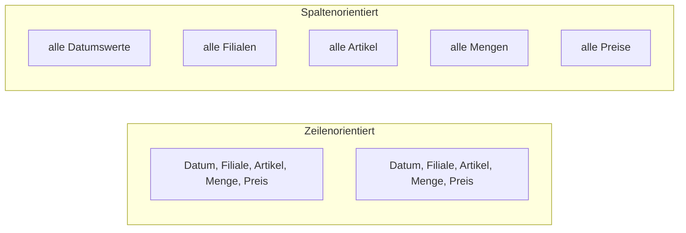

<!-- Auszug aus dem BID-Wiki (konzepte/column-oriented-storage.md), erzeugt am 2026-11-27 mit build_lernpaket.py. Nicht von Hand ändern. -->

# Column-Oriented Storage

## In einem Satz

Bei Column-Oriented Storage (spaltenorientierter Speicherung) liegen nicht die Werte einer Zeile beisammen, sondern alle Werte einer Spalte; eine Abfrage liest nur die Spalten, die sie braucht.

## Warum das wichtig ist

Analytische Abfragen betreffen typischerweise sehr viele Zeilen, aber nur wenige Spalten. Eine zeilenweise gespeicherte Tabelle zwingt die Datenbank, auch alle nicht benötigten Spalten von der Platte zu holen. Spaltenweise Speicherung ist der wichtigste Grund, warum heute ein einzelner Rechner Auswertungen schafft, für die früher ein Cluster nötig schien.

## Wie es funktioniert

- Jede Spalte wird für sich gespeichert. Die Reihenfolge der Zeilen ist in allen Spalten gleich: Der k-te Eintrag jeder Spalte gehört zur selben Zeile.
- Eine Abfrage lädt nur die angesprochenen Spalten.
- Werte einer Spalte sind einander ähnlich und lassen sich stark komprimieren, siehe Compression in Columns.
- Die Zeilen können nach einem Sortierschlüssel geordnet sein, meist dem Datum. Das beschleunigt Filter auf Zeiträume und verbessert die Kompression der ersten Sortierspalte.
- Geschrieben wird gesammelt: Neue Daten werden gepuffert und als neue Dateien ergänzt, nicht einzeln mitten in bestehende eingefügt.
- Engines verarbeiten die Spaltenwerte in Blöcken mit wenigen, einfachen Rechenschritten je Block (Vectorized Processing). Das nutzt moderne Prozessoren sehr gut aus.

Das Diagramm stellt zwei Zeilen mit je fünf Werten der Speicherung derselben Daten als fünf Spaltenblöcke gegenüber.

## Am Modehändler

Die Frage *Summe der Menge je Woche, Warengruppe und Filiale* braucht drei bis vier der rund 30 Spalten der Umsatztabelle.

Rechenbeispiel mit vereinfachender Annahme von 8 Byte je Wert und ohne Kompression: Zeilenweise sind 50 Mio. Zeilen mal 30 Spalten mal 8 Byte zu lesen, also 12 GB. Spaltenweise sind es bei drei Spalten 1,2 GB, ein Zehntel. Mit Kompression wird der Abstand noch größer. Deshalb liegen die Übungsdaten als Parquet vor, und deshalb rechnet DuckDB die nächtliche Absatzprognose auf einem Rechner.

## Trade-offs und Entscheidungsregel

- Spaltenorientiert für Auswertungen: viele Zeilen, wenige Spalten, Aggregation, gesammeltes Laden.
- Zeilenorientiert für operative Arbeit: einzelne Datensätze vollständig lesen und ändern.
- Preis: Einzelne Zeilen einzufügen oder zu ändern, ist teuer; eine ganze Zeile zu lesen, erfordert Zugriffe auf alle Spalten.
- Der direkte Vergleich steht in Row vs. Column Storage.

## Typische Fehlvorstellungen

- „Spaltenorientiert ist immer schneller.“ Für Buchungen und Einzelzugriffe ist es langsamer.
- „Das ist dasselbe wie Wide-Column-Datenbanken.“ Diese speichern trotz des Namens zeilenweise.
- „Der Gewinn kommt nur von der Kompression.“ Der erste Gewinn ist, nicht benötigte Spalten gar nicht zu lesen.

## Selbsttest

1. Eine Tabelle hat 40 gleich große Spalten, die Abfrage braucht 4. Welcher Anteil der Daten wird spaltenorientiert gelesen?
2. Warum wird in spaltenorientierte Speicher gesammelt geschrieben?
3. Welche Spalte eignet sich meist als erster Sortierschlüssel?

Lösung

1. Ein Zehntel.
2. Weil das Einfügen einer einzelnen Zeile alle Spaltendateien ändern müsste.
3. Die am häufigsten gefilterte, meist das Datum.

## Frag deinen AI-Agenten

- *Erkläre mir Column-Oriented Storage anhand der Seite `column-oriented-storage.md` im Lernpaket: zuerst in drei Sätzen für eine Managerin, dann technisch für einen Engineer, jeweils am Modehändler.*
- *Ich nenne dir eine Abfrage und die Zahl der Spalten und Zeilen einer Tabelle. Lass mich abschätzen, wie viel zeilen- und wie viel spaltenorientiert gelesen wird, und korrigiere meine Rechnung.*
- *Stelle mir nacheinander drei Fragen zu Column-Oriented Storage, warte jeweils auf meine Antwort und korrigiere sie nur anhand der Wiki-Seite; nenne die Stelle, auf die du dich stützt.*

## Verwandt

- Row vs. Column Storage
- Compression in Columns
- Parquet
- Data Warehouse

## Quelle und Weiterlesen

- DDIA 2e, Kap. 4 „Column-Oriented Storage“ S. 136
- DDIA 2e, Kap. 4 „Query Execution: Compilation and Vectorization“ S. 142
