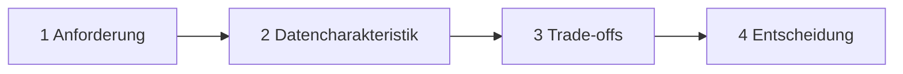

<!-- Auszug aus dem BID-Wiki (konzepte/entscheidungskette.md), erzeugt am 2026-11-27 mit build_lernpaket.py. Nicht von Hand ändern. -->

# Entscheidungskette

## In einem Satz

Die Entscheidungskette (eigene Synthese dieser Lehrveranstaltung, kein Begriff des Buches) ordnet jede Architekturentscheidung in vier Stufen: Anforderung, Datencharakteristik, Einschränkungen und Trade-offs, Entscheidung; Technologien kommen zuletzt.

## Warum das wichtig ist

Die teuersten Fehler in Datenprojekten entstehen, wenn jemand mit der Technologie beginnt: „Wir brauchen ein Cluster“, „wir brauchen Streaming“. Die Kette zwingt dazu, zuerst zu sagen, was die Anwendung verlangt, und erst am Ende, womit man es baut. Kernbotschaft: Große Datenmengen allein rechtfertigen noch kein verteiltes System.

## Wie es funktioniert

| Stufe | Frage | Woher die Antwort kommt |
|---|---|---|
| 1 Anforderung | Wie aktuell, wie oft, wie viel, wie verfügbar, wie skalierbar muss es sein? | die vier Qualitäten aus [Kapitel 2](kap-02.md): Performance, Reliability, Scalability, Maintainability |
| 2 Datencharakteristik | Welche Merkmale der Daten sind hier wirklich relevant? | die [5V](big-data-5v.md) als Fragen, nicht als Urteil |
| 3 Einschränkungen und Trade-offs | Was kostet mehr Aktualität, mehr Verteilung, mehr Betrieb, und was bringt es? | [Verteilt vs. Single-Node](distributed-vs-single-node.md), [Batch vs. Stream](batch-vs-stream.md), [Simplicity](simplicity.md) |
| 4 Entscheidung | Welche ist die einfachste ausreichende Lösung? Unter welcher Bedingung wäre die andere richtig? | Technologien erst jetzt, als Beispiele |

Die Reihenfolge ist Pflicht. Wer bei Stufe 4 beginnt, begründet rückwärts und übersieht, dass die Anforderung die Komplexität oft gar nicht verlangt.

Das Diagramm zeigt die vier Stufen als Kette von links nach rechts; jede Stufe setzt die vorige voraus.

## Am Modehändler

Nächtliche Absatzprognose: (1) Ergebnis bis 6 Uhr, einmal täglich, Ausfall einer Nacht verkraftbar. (2) Rund 50 Mio. Umsatzzeilen Historie, 20.000 neue je Tag, langsames Wachstum. (3) Streaming brächte Aktualität, die niemand braucht; ein Cluster brächte Betrieb und Fehlersuche ohne Nutzen. (4) Nächtlicher Batch auf einem Rechner. Andere Entscheidung erst, wenn der Lauf das Nachtfenster sprengt, die Daten nicht mehr auf einen Rechner passen, ein Ausfall nicht tolerierbar ist oder das Zehnfache absehbar ist.

Bestandsanzeige „noch 2 Stück in Graz“: dieselbe Datenrate, aber Stufe 1 verlangt Aktualität in Sekunden. Deshalb Stream, obwohl die Datenmenge je Ereignis winzig ist.

## Trade-offs und Entscheidungsregel

- Jede Begründung nennt alle vier Stufen in dieser Reihenfolge, auch wenn eine Stufe nur einen Satz braucht.
- Die einfachste ausreichende Lösung gewinnt; jeder zusätzliche Baustein braucht ein Problem, das er löst.
- Eine vollständige Entscheidung nennt auch die Bedingung, unter der die andere Entscheidung richtig wäre.
- Preis: Die Kette verlangt Zahlen zur Anforderung (Stunden, Sekunden, Zeilen); „schnell“ und „viel“ reichen nicht.

## Typische Fehlvorstellungen

- „Volume vorhanden, also verteilt.“ Die Menge allein erzwingt nichts.
- „Die Filialen sind verteilt, also Streaming.“ Datenherkunft ist nicht Architektur.
- „Excel schafft es nicht, also Big Data.“ Der Maßstab sind angemessene Werkzeuge, nicht die Tabellenkalkulation.
- „Echtzeit ist immer besser.“ Jede Sekunde weniger Verzögerung kostet Komplexität.

## Selbsttest

1. Nenne die vier Stufen in der richtigen Reihenfolge.
2. Ein Team schlägt Streaming für den Monatsbericht vor. Welche Stufe fehlt in der Begründung?
3. Was muss eine vollständige Begründung außer der Entscheidung noch nennen?

Lösung

1. Anforderung, Datencharakteristik, Einschränkungen und Trade-offs, Entscheidung.
2. Stufe 1: Der Monatsbericht verlangt keine Aktualität in Sekunden; Batch reicht.
3. Die Bedingung, unter der die andere Entscheidung richtig wäre.

## Frag deinen AI-Agenten

- *Hier ist meine Begründung für ein Szenario: „…“. Prüfe sie gegen die vier Stufen der Entscheidungskette aus [Entscheidungskette](entscheidungskette.md) und sag mir, welche Stufe fehlt oder nicht stimmt. Formuliere die Begründung nicht für mich.*
- *Gib mir eine neue Situation beim Modehändler in vier Sätzen. Ich entscheide entlang der Kette; du greifst die schwächste Stufe an.*

## Verwandt

- [Big Data und die 5V](big-data-5v.md)
- [Verteilt vs. Single-Node](distributed-vs-single-node.md)
- [Batch vs. Stream](batch-vs-stream.md)
- [Wegweiser Kapitel 2](kap-02.md)

## Quelle und Weiterlesen

- Eigene didaktische Synthese dieser Lehrveranstaltung in Anlehnung an DDIA 2e, Kap. 1 „Distributed Versus Single-Node Systems“ S. 19 und DDIA 2e, Kap. 2 „Defining Nonfunctional Requirements“ S. 33. Das Buch kennt keine Kette dieses Namens; Stufe 1 folgt der Gliederung von Kapitel 2.
