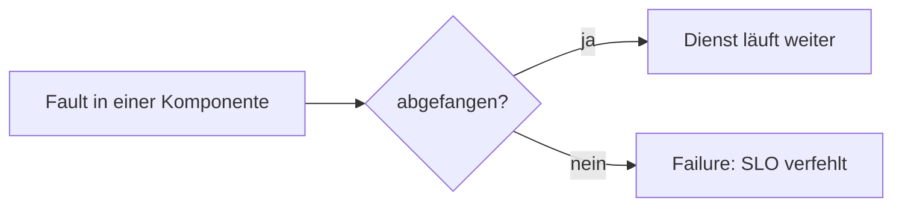

<!-- Auszug aus dem BID-Wiki (konzepte/fault-vs-failure.md), erzeugt am 2026-11-25 mit build_lernpaket.py. Nicht von Hand ändern. -->

# Fault vs. Failure

## In einem Satz

Ein Fault (Fehlerzustand) liegt vor, wenn ein Teil des Systems nicht mehr richtig arbeitet; ein Failure (Ausfall) liegt vor, wenn das System als Ganzes den geforderten Dienst nicht mehr erbringt.

## Warum das wichtig ist

Reliability (Zuverlässigkeit) bedeutet, dass ein System auch dann korrekt weiterarbeitet, wenn etwas schiefgeht. Teile gehen in jedem größeren System ständig kaputt. Das Ziel ist deshalb nicht, Faults zu verhindern, sondern zu verhindern, dass aus einem Fault ein Failure wird. Die Unterscheidung lenkt Geld dorthin, wo es wirkt.

## Wie es funktioniert

| | Fault | Failure |
|---|---|---|
| Ebene | einzelne Komponente | gesamter Dienst |
| Beispiele | Festplatte defekt, Rechner abgestürzt, externer Dienst nicht erreichbar | Nutzerinnen bekommen keine oder falsche Antworten |
| Maßstab | Komponente weicht von ihrer Spezifikation ab | Dienst verfehlt sein SLO |

Ob etwas Fault oder Failure ist, hängt von der Betrachtungsebene ab: Der Ausfall einer Festplatte ist für die Platte ein Failure, für den Rechner mit gespiegelten Platten nur ein Fault.

Eine Komponente, deren Fault unmittelbar zum Failure führt, heißt *Single Point of Failure*. Das Abfangen leistet [Fault Tolerance](fault-tolerance.md).

## Am Modehändler

- Kasse 3 in Graz stürzt ab, die übrigen Kassen verkaufen weiter: Fault.
- Die Internetleitung einer Filiale fällt aus, die Kasse puffert Buchungen lokal: Fault.
- Der Shop zeigt deshalb für ganz Graz eine Stunde lang keinen Bestand: Failure.
- Die Absatzprognose ist um 6 Uhr nicht fertig, das Ziel ist verfehlt: Failure.
- Ein Rechenfehler lässt alle Bestände falsch erscheinen: Failure, auch wenn technisch alles läuft.

## Trade-offs und Entscheidungsregel

- Für jede Komponente fragen: Was passiert mit dem Dienst, wenn genau sie ausfällt?
- Faults, die sich abfangen lassen, toleriert man. Faults, die sich nicht rückgängig machen lassen, etwa ein Datenabfluss an Unbefugte, muss man verhindern.
- Wie viel Zuverlässigkeit nötig ist, hängt vom Schaden ab: Ein Prototyp darf mehr riskieren als die Kassenabrechnung.

## Typische Fehlvorstellungen

- „Zuverlässig heißt: Es geht nichts kaputt.“ Zuverlässig heißt: Der Dienst bleibt erhalten, obwohl etwas kaputtgeht.
- „Ein Failure ist immer ein Absturz.“ Auch falsche Ergebnisse oder verfehlte Antwortzeiten sind Failures.
- „Faults sind seltene Ausnahmen.“ In großen Systemen sind sie Alltag.

## Selbsttest

1. Eine Festplatte im Bestandsserver fällt aus, die gespiegelte Platte übernimmt. Fault oder Failure?
2. Woran misst man, ob ein Failure vorliegt?
3. Richtig oder falsch: Ein System ohne Abstürze kann kein Failure haben.

Lösung

1. Fault. Der Dienst läuft weiter.
2. Am geforderten Dienst, konkret am SLO.
3. Falsch. Falsche Daten oder zu langsame Antworten sind ebenfalls Failures.

## Frag deinen AI-Agenten

- *Erkläre mir Fault vs. Failure anhand der Seite `fault-vs-failure.md` im Lernpaket: zuerst in drei Sätzen für eine Managerin, dann technisch für einen Engineer, jeweils am Modehändler.*
- *Ich nenne dir sechs Störungen aus meinem Betrieb. Lass mich jede als Fault oder Failure einordnen und frage bei jeder nach der Betrachtungsebene.*
- *Stelle mir nacheinander drei Fragen zu Fault vs. Failure, warte jeweils auf meine Antwort und korrigiere sie nur anhand der Wiki-Seite; nenne die Stelle, auf die du dich stützt.*

## Verwandt

- [Fault Tolerance](fault-tolerance.md)
- SLO und SLA
- Replication
- [Wegweiser Kapitel 2](kap-02.md)

## Quelle und Weiterlesen

- DDIA 2e, Kap. 2 „Reliability and Fault Tolerance“ S. 43
