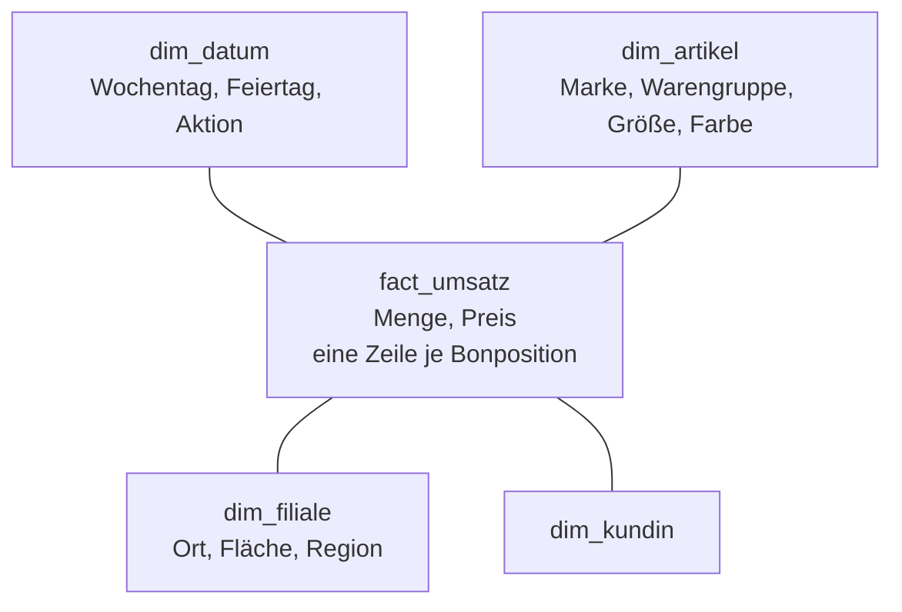

<!-- Auszug aus dem BID-Wiki (konzepte/star-schema.md), erzeugt am 2026-11-27 mit build_lernpaket.py. Nicht von Hand ändern. -->

# Star Schema

## In einem Satz

Ein Star Schema (Sternschema) ordnet Analysedaten um eine zentrale Faktentabelle mit einer Zeile je Ereignis an, umgeben von Dimensionstabellen, die das Ereignis beschreiben.

## Warum das wichtig ist

Auswertungen stellen immer ähnliche Fragen: Wie viel wurde wann, wo, wovon und an wen verkauft? Das Star Schema macht diese Fragen für Fachleute ohne Datenbankausbildung formulierbar und für die Datenbank schnell beantwortbar. Es ist die übliche Form von Daten im Data Warehouse und oft die Eingabe für Prognosemodelle.

## Wie es funktioniert

- **Faktentabelle:** eine Zeile je Ereignis, zum Beispiel je verkaufter Bonposition. Sie enthält Messwerte (Menge, Preis) und Fremdschlüssel auf die Dimensionen. Sie ist sehr lang und kann sehr viele Spalten haben.
- **Dimensionstabellen:** beschreiben das Wer, Was, Wo, Wann, Wie und Warum. Sie sind vergleichsweise klein.
- Auch das Datum ist eine Dimension, damit sich Feiertage oder Aktionszeiträume als Merkmale ablegen lassen.

Varianten:

- **Snowflake Schema:** Dimensionen werden weiter zerlegt, etwa Marke und Warengruppe als eigene Tabellen. Stärker normalisiert, aber umständlicher abzufragen.
- **One Big Table:** Die Dimensionen werden in die Faktentabelle hineinkopiert. Braucht mehr Speicher, spart Joins.

Ein Kauf mit mehreren Artikeln wird nicht als ein Datensatz gespeichert, sondern als mehrere Faktenzeilen mit demselben Zeitpunkt, derselben Filiale und derselben Kundin.

## Am Modehändler

Die rund 50 Mio. Umsatzzeilen sind die Faktentabelle: eine Zeile je Bonposition mit Menge und Preis. Dimensionen sind Filiale (42 Filialen und der Onlineshop), Artikel, Datum und, sofern eine Kundenkarte verwendet wurde, die Kundin. Ein Bon mit drei Artikeln ergibt drei Faktenzeilen. Die nächtliche Absatzprognose liest daraus Absatz je Artikel, Filiale und Woche.

Rechenbeispiel mit Annahmen: 42 Filialen mit je 180 Bons am Tag und durchschnittlich 2,3 Positionen ergeben rund 17.400 Faktenzeilen pro Tag, an 300 Verkaufstagen rund 5,2 Mio. pro Jahr.

## Trade-offs und Entscheidungsregel

- Star Schema, wenn Fachabteilungen mit SQL oder BI-Werkzeugen auswerten.
- Snowflake nur, wenn die zusätzliche Normalisierung einen klaren Pflegevorteil bringt.
- One Big Table, wenn Abfragegeschwindigkeit wichtiger ist als Speicherplatz und die Daten ohnehin nur gesammelt geladen werden.
- Denormalisierung ist hier unbedenklich, weil Fakten Vergangenes festhalten, das sich nicht mehr ändert. Zur Speicherung passt [Column-Oriented Storage](column-oriented-storage.md).

## Typische Fehlvorstellungen

- „Die Faktentabelle hat eine Zeile je Bon.“ Üblich ist eine Zeile je Position.
- „Das Star Schema ist für operative Systeme gedacht.“ Dort ist die normalisierte Form besser.
- „Dimensionen sind nur Beschriftung.“ Sie liefern die Merkmale, nach denen gefiltert und gruppiert wird.

## Selbsttest

1. Ordne zu: Menge, Marke, Filialfläche, Feiertag, Verkaufspreis. Was steht in der Faktentabelle, was in welcher Dimension?
2. Wie viele Faktenzeilen erzeugt ein Bon mit vier verschiedenen Artikeln?
3. Worin unterscheidet sich ein Snowflake Schema vom Star Schema?

Lösung

1. Menge und Verkaufspreis: Faktentabelle. Marke: Artikel. Filialfläche: Filiale. Feiertag: Datum.
2. Vier.
3. Die Dimensionen sind weiter in Untertabellen zerlegt.

## Frag deinen AI-Agenten

- *Erkläre mir Star Schema anhand der Seite `star-schema.md` im Lernpaket: zuerst in drei Sätzen für eine Managerin, dann technisch für einen Engineer, jeweils am Modehändler.*
- *Ich beschreibe dir einen Geschäftsprozess. Entwirf mit mir Faktentabelle und Dimensionen und frage zuerst: Was ist das Ereignis, das eine Zeile ergibt?*
- *Stelle mir nacheinander drei Fragen zu Star Schema, warte jeweils auf meine Antwort und korrigiere sie nur anhand der Wiki-Seite; nenne die Stelle, auf die du dich stützt.*

## Verwandt

- Data Warehouse
- Normalisierung vs. Denormalisierung
- [Column-Oriented Storage](column-oriented-storage.md)
- DataFrames

## Quelle und Weiterlesen

- DDIA 2e, Kap. 3 „Stars and Snowflakes: Schemas for Analytics“ S. 77
