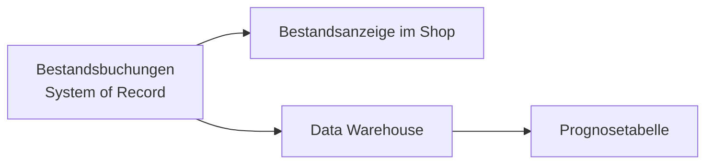

<!-- Auszug aus dem BID-Wiki (konzepte/system-of-record.md), erzeugt am 2026-11-25 mit build_lernpaket.py. Nicht von Hand ändern. -->

# System of Record

## In einem Satz

Ein System of Record (führendes System, auch *Source of Truth*) ist der Ort, an dem eine Information zum ersten Mal und verbindlich festgehalten wird; widersprechen sich zwei Systeme, gilt sein Wert.

## Warum das wichtig ist

Sobald Daten in mehreren Systemen liegen, entstehen Widersprüche. Wer vorab festlegt, welches System für welche Information führend ist, weiß im Streitfall, welche Zahl stimmt, was gesichert werden muss und was sich neu berechnen lässt. Das ist eine Entscheidung über Verantwortung und Budget, keine technische Feinheit.

## Wie es funktioniert

- Jede Tatsache wird im System of Record genau einmal gespeichert, meist in normalisierter Form.
- Neue Daten, etwa Eingaben von Kundinnen oder Buchungen, werden zuerst dort geschrieben.
- Alle anderen Darstellungen sind [Derived Data](derived-data.md) (abgeleitete Daten): Sie entstehen durch Kopieren, Umformen oder Verdichten und dürfen jederzeit neu erzeugt werden.
- Die Rolle hängt an der Nutzung, nicht am Produkt. Dieselbe Datenbanksoftware kann an einer Stelle führend und an anderer Stelle abgeleitet sein.

Das Diagramm zeigt die Bestandsbuchungen als einzige Quelle, aus der die Shop-Anzeige direkt und die Prognosetabelle über das Data Warehouse abgeleitet werden.

## Am Modehändler

Die Bestandsbuchungen (Wareneingang, Verkauf, Retoure, Umlagerung) und die Filialstammdaten sind System of Record. Die Anzeige „noch 2 Stück in Graz“ im Onlineshop, der Suchindex für Artikel, die Faktentabelle im Data Warehouse und die Tabelle mit der nächtlichen Absatzprognose sind abgeleitet. Zeigt der Shop 2 Stück und die Buchungen ergeben 1, dann ist 1 richtig und die Anzeige wird korrigiert, nicht umgekehrt.

## Trade-offs und Entscheidungsregel

- Gehen die Daten verloren und niemand kann sie wiederherstellen, dann ist es ein System of Record: höchste Anforderungen an Sicherung, Replication und Transaktionen.
- Lassen sich die Daten aus einer anderen Quelle neu berechnen, dann sind sie abgeleitet: Hier darf auf Geschwindigkeit optimiert werden.
- Kosten: Wer ein führendes System festlegt, muss alle Schreibwege dorthin lenken. Schreibt eine Anwendung direkt in eine abgeleitete Kopie, laufen die Systeme auseinander.

## Typische Fehlvorstellungen

- „Das System of Record ist die größte oder modernste Datenbank.“ Nein, es ist eine Rolle. Auch eine einfache Datei kann führend sein.
- „Es gibt genau ein System of Record im Unternehmen.“ Nein, es gibt eines je Information: Bestand im Warenwirtschaftssystem, Kundendaten im CRM.
- „Abgeleitete Daten sind weniger wichtig.“ Sie sind für die Lesegeschwindigkeit oft unverzichtbar, aber ersetzbar.

## Selbsttest

1. Der Suchindex des Onlineshops wird versehentlich gelöscht. Ist das ein Datenverlust im engeren Sinn?
2. Richtig oder falsch: Ob eine PostgreSQL-Datenbank System of Record ist, hängt vom Produkt ab.
3. Shop-Anzeige und Buchungssystem nennen unterschiedliche Bestände. Welcher Wert gilt?

Lösung

1. Nein. Der Index ist abgeleitet und wird aus dem Artikelstamm neu aufgebaut; es kostet Zeit, aber keine Information.
2. Falsch. Entscheidend ist die Nutzung: Dieselbe Software kann führend oder abgeleitet sein.
3. Der Wert des Buchungssystems, weil es als System of Record festgelegt ist.

## Frag deinen AI-Agenten

- *Erkläre mir System of Record anhand der Seite `system-of-record.md` im Lernpaket: zuerst in drei Sätzen für eine Managerin, dann technisch für einen Engineer, jeweils am Modehändler.*
- *Ich nenne dir sechs Datenbestände meines Unternehmens. Frage mich zu jedem, ob er System of Record oder Derived Data ist, und prüfe meine Begründung mit der Regel „rekonstruierbar oder nicht“.*
- *Stelle mir nacheinander drei Fragen zu System of Record, warte jeweils auf meine Antwort und korrigiere sie nur anhand der Wiki-Seite; nenne die Stelle, auf die du dich stützt.*

## Verwandt

- [Derived Data](derived-data.md): das Gegenstück
- Event Sourcing: ein Ereignislog als System of Record
- ETL: der Weg von führenden Systemen ins Warehouse
- Wegweiser Kapitel 1

## Quelle und Weiterlesen

- DDIA 2e, Kap. 1 „Systems of Record and Derived Data“ S. 10
